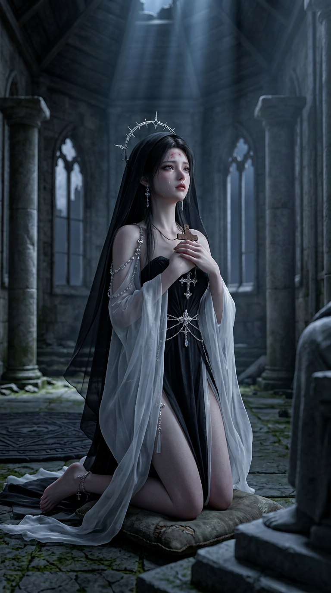

# EP000 · 图片资产实物清单（2026-10-15）

## 画风与制作边界

- 正式修女身份图／全剧技术画风图：`../../../输入/参考图/REF-XIWEIER-修女定稿.jpeg`。旧 `images/IMG-XIWEIER-SHEET.png` **不是**创作者定稿，不纳入以下生成数。
- 按创作者最新分域口径（`CD-0010`）：**场景为西方魔幻幻想风格，林恩是乙游美型 3D CG**；共用高精度 UE5 三维电影 CG 材质和柔光，拒绝真人摄影与迪士尼卡通。中国仙侠 CG 指渲染水准，不把教堂改成道观。
- 实际生成顺序：先造林恩人形→目视检查→以**同一人形图片**加修女画风图作参考生成石像→目视检查。人形只是雕工原型，EP000 剧情仍只出现石像。
- 下表是**真实存在的单张单视角 PNG**，并非原《图片提示词.md》描述的多视角拼版。每张图目前仅为制作候选、尚未经创作者逐张定稿；文件名叫 `PLATE` 或 `SHEET` 不代表已完成三视图或镜头起始帧。创作者可据图挑选／要求修订。

| 资产 ID | 路径（相对本清单） | 目视检查与待修正项 |
|---|---|---|
| IMG-LINN-HUMAN-SHEET | [查看图片](images/IMG-LINN-HUMAN-SHEET.png) | 已生成；乙游美型男性、后束黑发、墨色高领长袍，单幅正面全身；制作母版，不进正片。 |
| IMG-LINN-STATUE-SHEET | [查看图片](images/IMG-LINN-STATUE-SHEET.png) | 已生成；继承人形长发／五官／衣褶，坐姿灰石、正中额裂、蛛网、台座缺角、双眼无光。 |
| IMG-CORPSE-SHEET | [查看图片](images/IMG-CORPSE-SHEET.png) | 已生成**待重做质地**；复眼、大嘴、蹄足和大体量可读，但目前更像石质构造体，缺少剧本里的腐肉与明显黄绿色黏液。首次直接要求强烈腐败的生成触发内容限制，下一轮用非血腥湿润异变材质再试。 |
| IMG-PLAYERS-BRIEFS-SHEET | [查看图片](images/IMG-PLAYERS-BRIEFS-SHEET.png) | 已生成**待重做画风**；光头、普通男性、白色棉布大裤衩、赤脚符合造型，但皮肤偏真人摄影，需往同剧的 CG 游戏角色靠。此图只是一具共用躯体，不是五位不同角色。 |
| IMG-CHAPEL-PLATE | [查看图片](images/IMG-CHAPEL-PLATE.png) | 已生成夜间西方魔幻教堂；南门破损、四柱、北端石像、中部圆阵、屋顶破洞均可读；法阵盘体目前有微凸感，下一轮法阵特写应以刻入地面为准。 |
| IMG-CHAPEL-DAWN-PLATE | [查看图片](images/IMG-CHAPEL-DAWN-PLATE.png) | 已以夜间图作为参考生成；同机位／同构造清晨灰蓝天光，石像双目仍无光。 |
| IMG-DORM-PLATE | [查看图片](images/IMG-DORM-PLATE.png) | 已生成；近未来宿舍两侧铁架床、窗帘和暖色城光。原设定东侧书桌在镜头后方不出镜；当前窗帘有缝，可在后续镜头构图关闭。 |
| IMG-DOORPLANK | [查看图片](images/IMG-DOORPLANK.png) | 已生成；有锈钉与尖锐锯齿断面、干燥无血，单板。 |
| IMG-ROPE | [查看图片](images/IMG-ROPE.png) | 已生成；俯拍粗麻绳、两端起毛、未受力。 |
| IMG-CROSS | [查看图片](images/IMG-CROSS.png) | 已生成；掌大生锈铁十字、顶部穿孔与松系麻绳，非修女银饰。 |
| IMG-CIRCLE | — | **未生成**：本轮调用达到工具每轮十张上限；下轮先生成未激活、与地面同色且刻入石板的圆阵。 |
| IMG-HEADSET | — | **未生成**：同上；需二手哑光划痕、胶带补痕、罩内冷白光。 |
| IMG-PANEL | — | **未生成**：需血红半透明板，逐字准确中文 `警告！信仰值 -10`；若图生文字不可读需文字排版层重做，不得沿用乱码。 |
| IMG-FORUM | — | **未生成**：需黑底论坛置顶帖，标题逐字为 `《古神苏醒》跨时代 100% 真实 VR 沉浸网游 · 首测仅限 5 人 · 点击即玩`；帖子正文只留下载链接；不可用伪中文代替。 |

## 希维尔场景关键帧试拍（单张，不计入资产板）

[查看 `KF-EP000-004-XIWEIER-PRAYER-PREVIEW.png`](images/KF-EP000-004-XIWEIER-PRAYER-PREVIEW.png)：参照 SHOT-EP000-004 的**动作中段**，希维尔从磕头姿势抬起额头的瞬间，面容可见，跪在北端神台前的蒲团上，双手握单独的生锈十字架。输入分别为创作者定稿修女图（身份＋渲染）、`IMG-CHAPEL-PLATE.png`（西方魔幻夜间教堂空间）、`IMG-CROSS.png`（手持道具）；单幅竖屏、月光，供查看角色进入实际场景后的画面效果。它**不是** SHOT-EP000-004 当前《分镜.md》里“额头仍贴在石板上”的冻结起始帧，未替换那个 `PLAN-SHOT-START`，也不是 15 秒视频或经 provider adapter 验收的镜头。

## 生产状态

这十张是本会话 `generate_image` 生成并目视检查的静态**候选资产**，未由 `$short-drama-produce` provider adapter preview／confirm／run，未通过那个流程的生产验收；不作为已经挂载的 `REF-...` 视频 job，也不等于各镜 `PLAN-SHOT-START` 真正的起始帧。《分镜.md》里的 `PLAN-...` 暂不批量改名，等缺项、偏差项修正并完成逐镜用途核对再按内容绑定。EP000 的 Seedance 2.5 每次选 15 秒／可挂多图的约定仍有效，本轮**没有**视频任务或已生成视频。

## 重点样张

林恩人形（仅雕工母版）：

同一人形雕出的石像（EP000 出镜形态）：

西方魔幻幻想教堂夜景：

