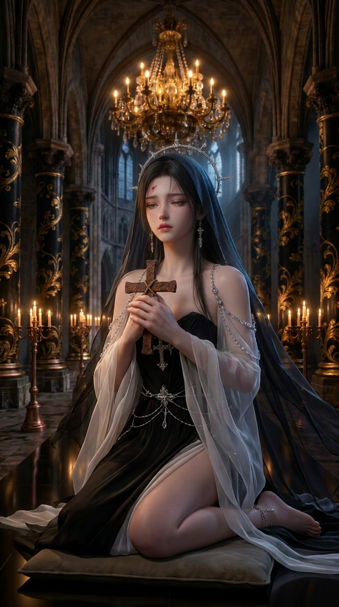
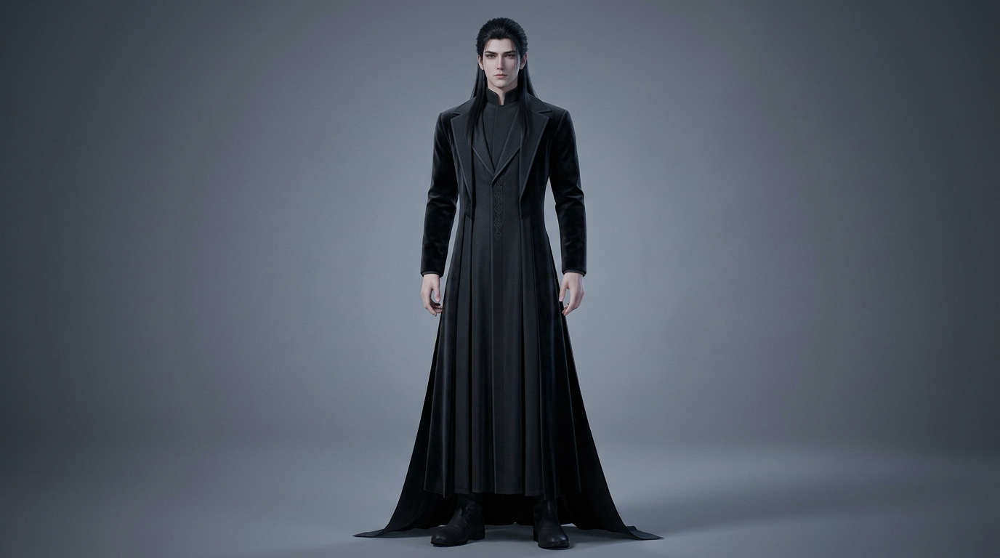
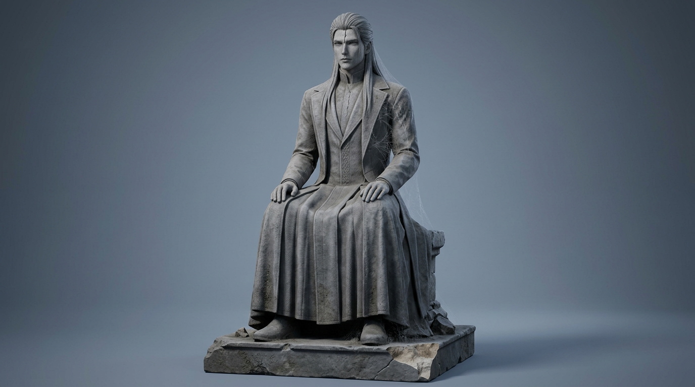
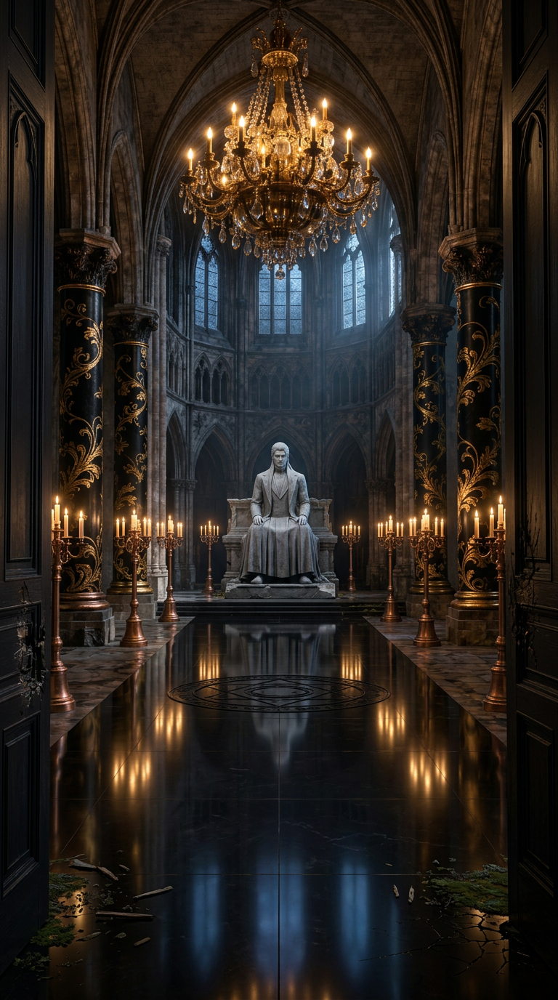

# EP000 · 图片资产实物清单（2026-10-15）

## 画风与制作边界

- 正式修女身份图／全剧技术画风图：`../../../输入/参考图/REF-XIWEIER-修女定稿.jpeg`。旧 `images/IMG-XIWEIER-SHEET.png` **不是**创作者定稿，不纳入以下生成数。
- **现行 `CD-0011`**：创作者将教堂改为华丽黑金哥特奇观（高尖拱、黑金柱饰、水晶烛灯、镜面石地、暖金烛火／冷蓝月光），不再以原著的整体贫穷破败作为镜头审美目标；剧情的南门、复活阵、裂额男像和局部战损仍可拍。建筑氛围图 `../../../输入/参考图/REF-CHAPEL-黑金哥特氛围-构图参考.png` 只约束建筑／光线，不复制女性翼像／深水池／水印；修女身份仍由正式定稿图锁定，林恩仍为乙游美型男像。
- 实际生成顺序：先造林恩人形→目视检查→以**同一人形图片**加修女画风图作参考生成石像→目视检查。人形只是雕工原型，EP000 剧情仍只出现石像。
- 下表是**真实存在的单张单视角 PNG**，并非原《图片提示词.md》描述的多视角拼版。每张图目前仅为制作候选、尚未经创作者逐张定稿；文件名叫 `PLATE` 或 `SHEET` 不代表已完成三视图或镜头起始帧。创作者可据图挑选／要求修订。**黑金哥特新版教堂夜／晨空镜已生成候选图**，但没有创作者逐张定稿；旧版粗石夜／晨板另存 `images/IMG-CHAPEL-PLATE-ROUGH-RETIRED.png` 与 `images/IMG-CHAPEL-DAWN-ROUGH-RETIRED.png`，不得挂到新镜头。

| 资产 ID | 路径（相对本清单） | 目视检查与待修正项 |
|---|---|---|
| IMG-LINN-HUMAN-SHEET | [查看图片](images/IMG-LINN-HUMAN-SHEET.png) | 已生成；乙游美型男性、后束黑发、墨色高领长袍，单幅正面全身；制作母版，不进正片。 |
| IMG-LINN-STATUE-SHEET | [查看图片](images/IMG-LINN-STATUE-SHEET.png) | 已生成；继承人形长发／五官／衣褶，坐姿灰石、正中额裂、蛛网、台座缺角、双眼无光。 |
| IMG-CORPSE-SHEET | [查看图片](images/IMG-CORPSE-SHEET.png) | 已生成**待重做质地**；复眼、大嘴、蹄足和大体量可读，但目前更像石质构造体，缺少剧本里的腐肉与明显黄绿色黏液。首次直接要求强烈腐败的生成触发内容限制，下一轮用非血腥湿润异变材质再试。 |
| IMG-PLAYERS-BRIEFS-SHEET | [查看图片](images/IMG-PLAYERS-BRIEFS-SHEET.png) | 已生成**待重做画风**；光头、普通男性、白色棉布大裤衩、赤脚符合造型，但皮肤偏真人摄影，需往同剧的 CG 游戏角色靠。此图只是一具共用躯体，不是五位不同角色。 |
| IMG-CHAPEL-PLATE | [查看图片](images/IMG-CHAPEL-PLATE.png) | **新版候选已出图**：黑金雕饰四柱、悬垂晶灯、金烛／冷蓝窗光、镜面硬质地面、中部暗法阵和北端唯一灰石男像；旧粗石图已归档，尚待创作者审美验收。 |
| IMG-CHAPEL-DAWN-PLATE | [查看图片](images/IMG-CHAPEL-DAWN-PLATE.png) | **新版候选已出图**：以黑金夜景为输入改冷金晨光，门、四柱、晶灯、法阵与北端男像位置保持；旧粗石图归档。 |
| IMG-DORM-PLATE | [查看图片](images/IMG-DORM-PLATE.png) | 已生成；近未来宿舍两侧铁架床、窗帘和暖色城光。原设定东侧书桌在镜头后方不出镜；当前窗帘有缝，可在后续镜头构图关闭。 |
| IMG-DOORPLANK | [查看图片](images/IMG-DOORPLANK.png) | 已生成；**旧版候选需重做暗金边框**：锈钉、尖锐锯齿断面和干燥无血可复用，木板装饰未与新版黑金南门一致。 |
| IMG-ROPE | [查看图片](images/IMG-ROPE.png) | 已生成；俯拍粗麻绳、两端起毛、未受力。 |
| IMG-CROSS | [查看图片](images/IMG-CROSS.png) | 已生成；掌大生锈铁十字、顶部穿孔与松系麻绳，非修女银饰。 |
| IMG-CIRCLE · 暗黑破损候选 | [查看图片](images/IMG-CIRCLE-RUIN-WIDE-CANDIDATE.png) | **新增候选**：未激活圆阵刻在硬质石地中，底部局部画幅被近景截断；仅夜景细节，不等同逐镜首帧，仍待与夜／晨空镜的线条一致性核验。 |
| IMG-HEADSET · 宿舍候选 | [查看图片](images/IMG-HEADSET-CANDIDATE.png) | **新增候选**：哑光划痕、胶带补痕、罩内冷白光；无人佩戴，仍需在 SHOT-011 冻结帧核对道具相对人物位置。 |
| IMG-PANEL | — | **未生成**：需血红半透明板，逐字准确中文 `警告！信仰值 -10`；若图生文字不可读需文字排版层重做，不得沿用乱码。 |
| IMG-FORUM | — | **未生成**：需黑底论坛置顶帖，标题逐字为 `《古神苏醒》跨时代 100% 真实 VR 沉浸网游 · 首测仅限 5 人 · 点击即玩`；帖子正文只留下载链接；不可用伪中文代替。 |

## 教堂备选 · 暗黑破损横屏（尚未替换正式场景锚）

创作者比较新一轮两张备选后选择了[暗黑破损教堂横屏候选](images/IMG-CHAPEL-RUIN-WIDE-REFINED-CANDIDATE.png)的选项 1。原模型文件带上下黑边，现已裁为真正的 **1536×864 / 16:9**；它是**偏好的探索方向，不是已定稿空镜**。屋顶、侧廊和彩窗损毁更明显，中轴圆阵仍可辨；但南门双扇未入画，石像额裂也无法从此远景核验。因此不覆盖旧夜／晨候选图、不作为 33 镜输入。生成原提示词、裁切与未完成项见[横屏方案记录](教堂横屏暗黑废墟-候选记录.md)。

本轮继续制作的四张静态候选均已目视检查并裁为 **1360×765／准确 16:9**：[南门开场反向机位候选](images/KF-EP000-001-SOUTH-DOOR-RUIN-WIDE-REVISED.png)——双扇紧闭、门闩尚完整，没有裂缝或人物，仍须与北端神台的南北反向机位做空间对账，**不把它直接升级为 SHOT-001 首帧**；[同空间清晨场景候选](images/IMG-CHAPEL-RUIN-DAWN-WIDE-ALTAR-CORRECTED.png)——破口、侧窗、圆阵及高台大体继承所选夜景，男像已回到高台而非中央地面，但远景仍看不清额裂，也没有 SHOT-032 的睡着修女，**仅空景地理参考**。另有上表的圆阵与 VR 头盔候选。四张都没有人物恐怖倒置脸或血腥。实际输入、最终编辑提示词与 QA 见[本轮继续生成记录](继续生成-横屏场景与道具-2026-10-15.md)。

## 希维尔场景关键帧试拍（单张，不计入资产板）

[旧粗石背景试拍](images/KF-EP000-004-XIWEIER-PRAYER-PREVIEW.png)及其[旧背景面部修订试验](images/KF-EP000-004-XIWEIER-PRAYER-IDENTITY-TEST.png)：面貌未稳定继承正式修女图，背景已过期，不能绑定新版分镜。原试拍处于动作中段，不是当前分镜“**额头刚离开黑石地面、脸可辨**”的冻结起始时点。

**本轮新版黑金背景试拍**：[首试](images/KF-EP000-004-XIWEIER-PRAYER-GOTHIC-TEST.png)、[面部裁片局部修订](images/KF-EP000-004-XIWEIER-PRAYER-GOTHIC-FACE-RETRY.png)及[低头动作重试](images/KF-EP000-004-XIWEIER-PRAYER-GOTHIC-LOW-ANGLE-TEST.png)。建筑、烛灯、冷月光、可行走石地与独立手持铁十字架更接近现行视觉设定；但首试脸部偏泛化圆眼，修订后杏眼稍近正式定稿仍未能确认一对一同人，且三张都跪坐过直，缺“刚抬离地面”的身体动势。**均为待修候选，均不替换 `PLAN-SHOT-START`，不是 15 秒视频或已验收镜头**。[查看三轮实际输入、原提示词与逐项验收记录](KF-EP000-004-黑金教堂试拍记录.md)。

**暗黑破损横屏场景·正常跪姿试拍**：[查看新生成的非恐怖祈祷关键帧候选](images/KF-EP000-004-XIWEIER-PRAYER-RUIN-WIDE-TEST.png)，1536×864。修女端正跪着、正常面容、独立手持铁十字，石像位于北端，没有倒置／倒吊或血腥元素。但蒲团误落在中央法阵上（应在石像台阶前），脸部身份与石像额裂也不足以凭此中远景定稿；这张采用静态祈祷姿态，**不是**现行分镜“额头刚离地”的冻结起点，不绑定 `PLAN-SHOT-START`。[实际输入、原提示词与验收差异](KF-EP000-004-暗黑横屏祈祷试拍.md)。

## 有人物关键帧继续试拍（横屏 16:9）

本轮新增四张**安全候选**：[SHOT-004 神台前祈祷](images/KF-EP000-004-XIWEIER-ALTAR-NEAR-LIFT-CANDIDATE.png)、[SHOT-013 五名玩家](images/KF-EP000-013-FIVE-PLAYERS-RUIN-WIDE-CANDIDATE.png)、[SHOT-030 希维尔站姿](images/KF-EP000-030-XIWEIER-STANDING-RUIN-WIDE-CANDIDATE.png)、[SHOT-033 清晨睡姿](images/KF-EP000-033-XIWEIER-DAWN-RUIN-WIDE-CANDIDATE.png)。均为准确 1360×765，未见倒置人脸、怪异关节或血腥；但 SHOT-004 额头仍高于“刚离地”起点、SHOT-013 五人同脸不完全且少怪物后景、SHOT-030 铁十字挂件缺失、SHOT-033 远景脸和男像额裂无法可靠核对。**没有一张可直接替换正式 `PLAN-SHOT-START` 或作为视频已挂的 `REF-...`。**本轮真实中文提示词／参考顺序／失败重试与逐镜 QA 见[有人物关键帧记录](有人物关键帧-2026-10-15.md)。

## 生产状态

目前图像既有 `generate_image` 单张静态**候选资产**也有两张明确标记过期的粗石场景对照图。CD-0011 的夜／晨两张黑金教堂空镜已生成；希维尔在黑金建筑里三张早期试拍仍有面部漂移和动作偏差，另在创作者偏好的暗黑破损横屏候选场景里新增一张安全跪祷试拍，但该试拍的法阵／蒲团地理、冻结时点及人物身份尚未过关。本轮又新增南门、晨景、圆阵、头盔四张候选；南门反向镜头尚未完成整座建筑地理验收，晨景男像的远景额裂仍不可辨，不能据此批量挂 `REF-...`。未由 `$short-drama-produce` provider adapter preview／confirm／run，也未通过该流程的生产验收；新试拍不作为已挂载的 `REF-...` 视频 job，不等于 SHOT-EP000-004 的 `PLAN-SHOT-START` 真正起始帧。《分镜.md》其他 `PLAN-...` 暂不批量改名，待缺项、偏差项修正及逐镜核对后再按内容绑定。EP000 的 Seedance 2.5 每次选 15 秒／可挂多图的约定仍有效，本轮**没有**视频任务或已生成视频。

## 重点样张

林恩人形（仅雕工母版）：

同一人形雕出的石像（EP000 出镜形态）：

现行黑金哥特教堂夜景**候选**（仍未定稿或成为起始帧）：

