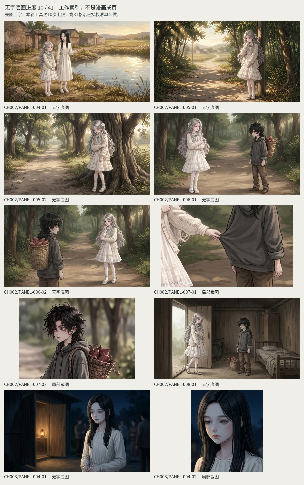
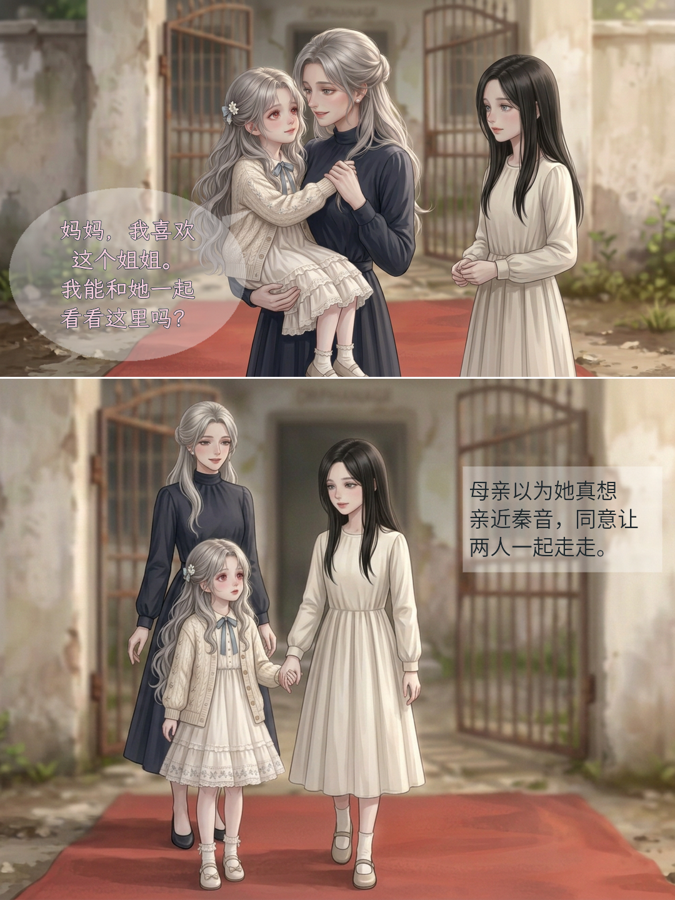
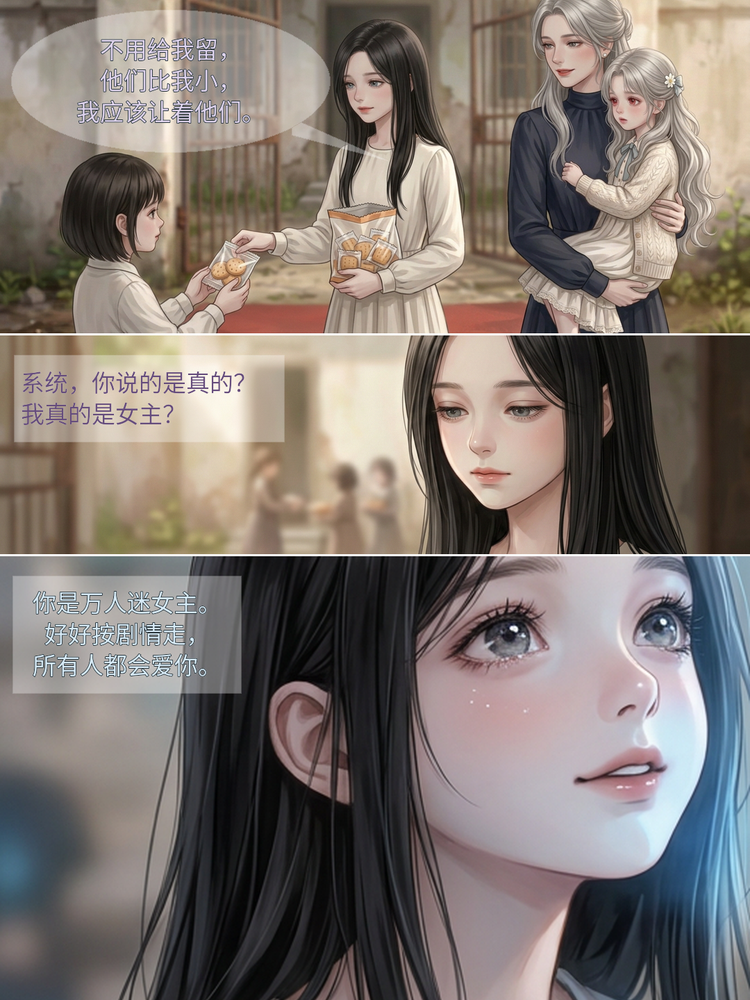
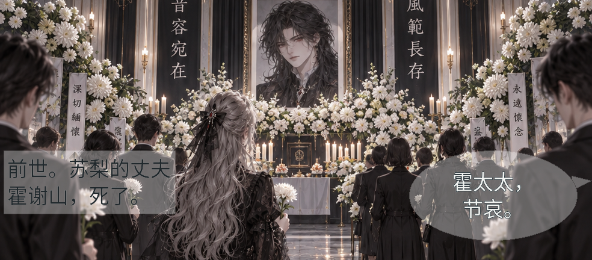
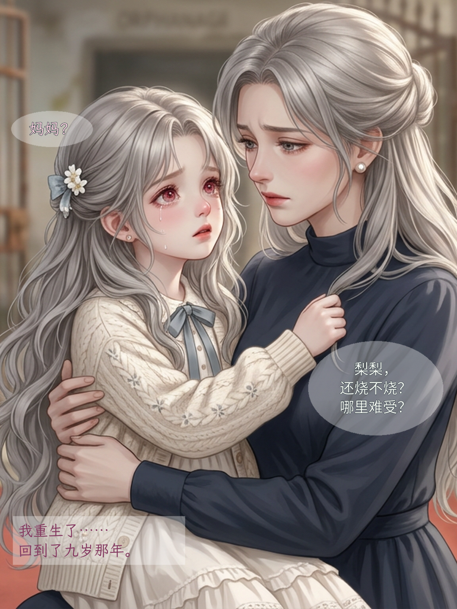
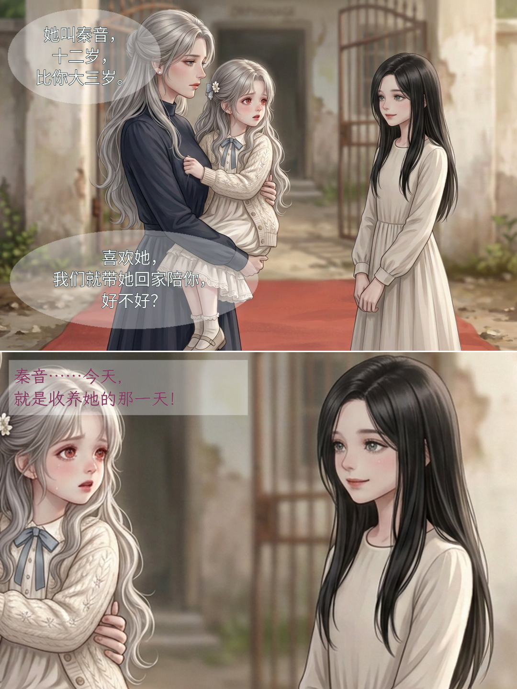

# 漫画制作文件入口

## 最新：先齐童年底图，后统一贴字

按创作者“A 后续话也制作了先把图都制作完”调整：不再逐页停在排字/开工确认；连续处理现有CH002余20格与CH003全21格，共41个明确童年缺图。**当前10/41格就绪，31格沿已授权队列待工具新轮继续；并未全部完成。**

[看10格实际PNG与剩余清单](连续童年出图/看图索引.md) · [实际调用/裁切/限额记录](连续童年出图/制作记录.md) · [当前同源提示词](连续童年出图/完整提示词.txt)

本轮10次成功出图已到工具单轮上限，另3请求被直接拒绝、未产图。7整幅采用、2整幅只取准确局部、1整幅未用；再加1同瞬间反应裁图，共10格。没有新贴字页，不把限额暂停说成待用户重新审批，也不拿错误整图/占位凑齐。成年、未定时期回忆、中段未整合部分仍单列。

## 已完成保留：第二话第3页出图与贴字

A两项已直接执行：**上格仍抱着请求同行，下格已落地/牵手/母亲空手**。先核原著和唯一分镜，再出2张无字图，各调用一次，无追加重试；画风沿用，不重复等同批开工。

[第3页看图/原图/来源](开篇修订/第002话/制作成果/第三页-v5/看图说明.md) · [本批两格记录](开篇修订/第002话/出图交接/第三页童年两格/核对与制作单.md)

1080×1440、3px白缝，无姓名标签/白字带；上格苏梨全文文楷36px，下格保原第三人称黑体旁白34px，不造母亲台词或女主内心。当前第2–3页可连续看，**不是完整前3页/全话**；第1页前世回忆仍待核，成年图责任不变。

## 第二话首批：三项已出图，第2页已贴字

按创作者C及“童年剧本核准后直接出图”执行：三项1改2补，实际3次调用、无重试。先核原著/分镜/上话，再画回应母亲、分自己的零食、秦音私有问系统；不是换新画风或扩成全量童年。

[看图/三张无字原图/来源](开篇修订/第002话/制作成果/画内贴字-v5/看图说明.md) · [首格局部贴字](开篇修订/第002话/制作成果/画内贴字-v5/首格局部/PANEL-001-01.png) · [当前批次记录](开篇修订/第002话/出图交接/第二话首批/核对与制作单.md)

第2页1080×1440、3px细分隔；第1页只交首格984×660，其前世回忆阶段仍待核。**不是连续两页/全话完成或用户/平台验收。** 原有31块正文/身份不改，系统不让苏梨听见；成年仍由创作者负责。

## 已有成年首格 v5（局部）

创作者选A，现有灵堂首格已按v5贴字：左侧半透明矩形旁白、右侧轻椭圆来客画外对白，尾巴靠右格缘，不指遗照。两块正文/叙述身份不改，不造女主内心或男主发言。

[首格看图/来源/复现](开篇修订/第001话/制作成果/成年首格-v5/看图说明.md) · [成年四格待回图](开篇修订/第001话/出图交接/核对与制作单.md)

**984×432是单格局部，不是完整第1页或新增独幅故事页。** 页内其他两格仍缺；没有新生图，也没有把一格拉伸/填白成完整页。童年两页v5继续如下，PNG与源正文不变。

## 童年两页：参考式贴字＋细白分隔 v5

按创作者新附图重排第8–9页：**轻椭圆对白、半透明矩形内心，格缝24px→3px，外白边/粗黑框去掉**。用完整正文的专属字体、字色和位置辨人，不印姓名标签，不照搬参考剧情。原画和本轮之前的六块正文不变，无新生图调用。

图片可在工作区直接看，当前分支也保留必要文件。**仍是两页局部试排，待看图反馈，不是整话或平台验收。**

[看图说明/来源](开篇修订/第001话/制作成果/画内贴字-v5/看图说明.md) · [贴字规范](贴字规范.md) · [用户格式参考来源](贴字参考/用户参考来源.json)

### 第8页：重生独幅

### 第9页：收养提议与内心，3px细分隔

## 制作资料

- [修订总览](修订总览.md) · [第001话真源](开篇修订/第001话/漫画分镜.md) · [第002话真源](开篇修订/第002话/漫画分镜.md) · [第003话真源](开篇修订/第003话/漫画分镜.md)。
- [第二话首批五格审计/三项生成记录](开篇修订/第002话/出图交接/第二话首批/核对与制作单.md)，本轮已按C直接完成既定三项，未扩其他批次。
- [成年四格交接](开篇修订/第001话/出图交接/核对与制作单.md)，仍等创作者回图；其余候选格位须回真图按新规范重排，不冒称已完成全话细缝。
- [漫画skill](../skills/static-comic/SKILL.md) · [制作技巧](../skills/static-comic/references/production-learning.md) · [记忆存档](记忆存档.md)。

五稿54页/126格/152文字块是候选文本体量，不是成品页数。旧v4/v3/名签样张与旧哈希留历史，不冒充新规范；权利/阅读入口/实机平台核验仍待完成，未上传漫画平台。
