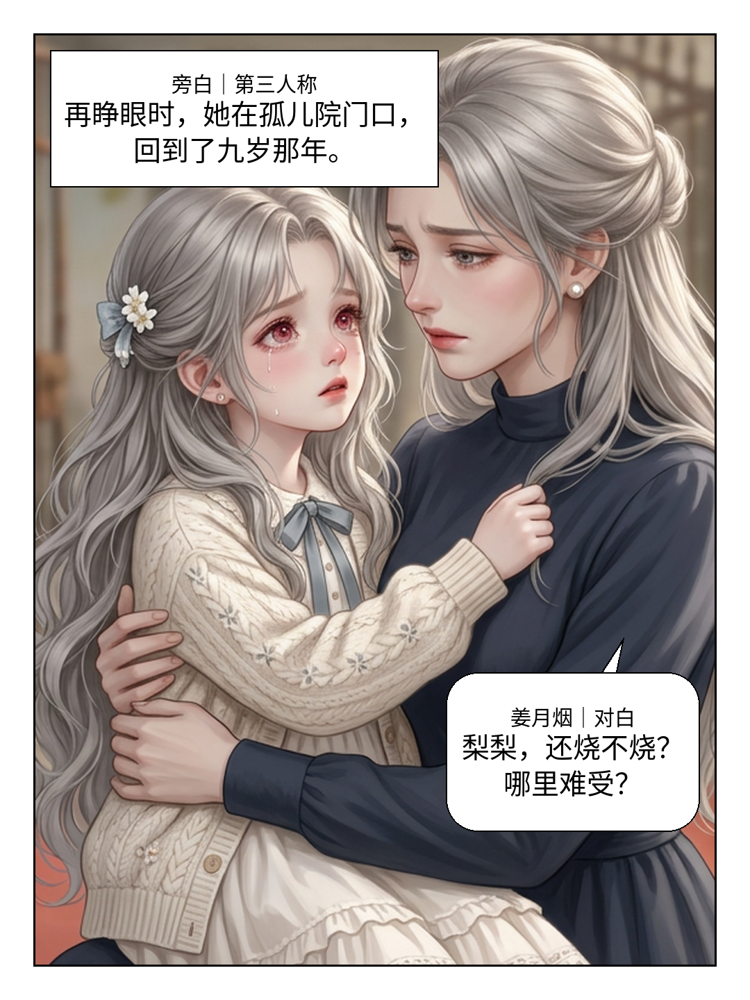
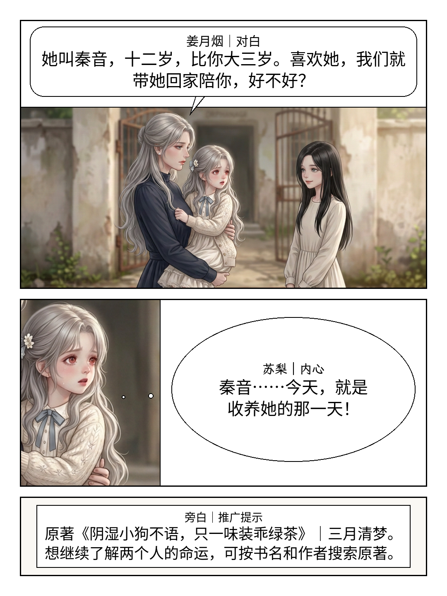

# 漫画制作文件入口

这里是当前工作分支里的实际文件，不依赖工作区viewer。点下方图片可看原尺寸；本文和相对链接随分支一起更新。

## 先看这两页

**首话第8–9页局部实图试排，非整话或平台发布验收。** 沿已认可童年画风；完整说明与来源在[看图说明](开篇修订/第001话/制作成果/实图试排-v3/看图说明.md)。

### 第8页：重生认出母亲

### 第9页：介绍与反应多镜

## 当前文本与制作资料

- [修订总览](修订总览.md)：范围、计数和仍未完成的工作。
- [第001话分镜](开篇修订/第001话/漫画分镜.md) · [第002话分镜](开篇修订/第002话/漫画分镜.md) · [第003话分镜](开篇修订/第003话/漫画分镜.md)：正文唯一来源，不等于各话已画完。
- [成年四格交接](开篇修订/第001话/出图交接/核对与制作单.md)：青年/成年由创作者制作，童年仍由助手负责。
- [漫画skill](../skills/static-comic/SKILL.md) · [制作技巧](../skills/static-comic/references/production-learning.md)：规则和可复用优化。
- [每轮记忆存档](记忆存档.md)：实际进度、证据、未决与下一步。

只保存选用图、必要参考与制作文件；未采用图、字体二进制和临时验证日志不放入此目录。权利、真实阅读入口和手机/平台检查仍待完成，未上传漫画平台。
