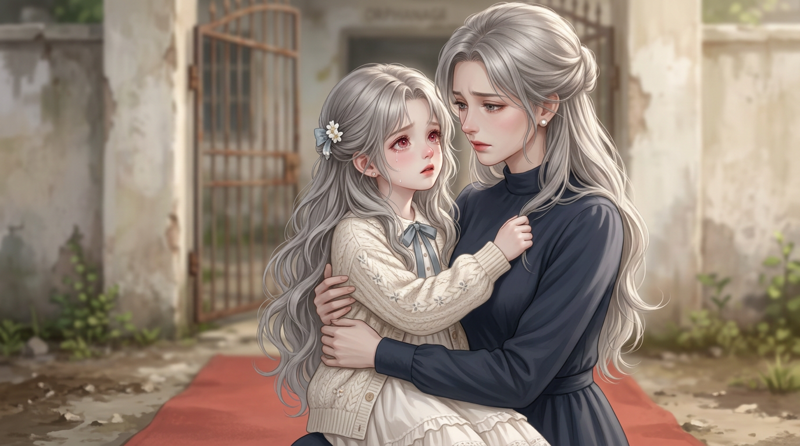
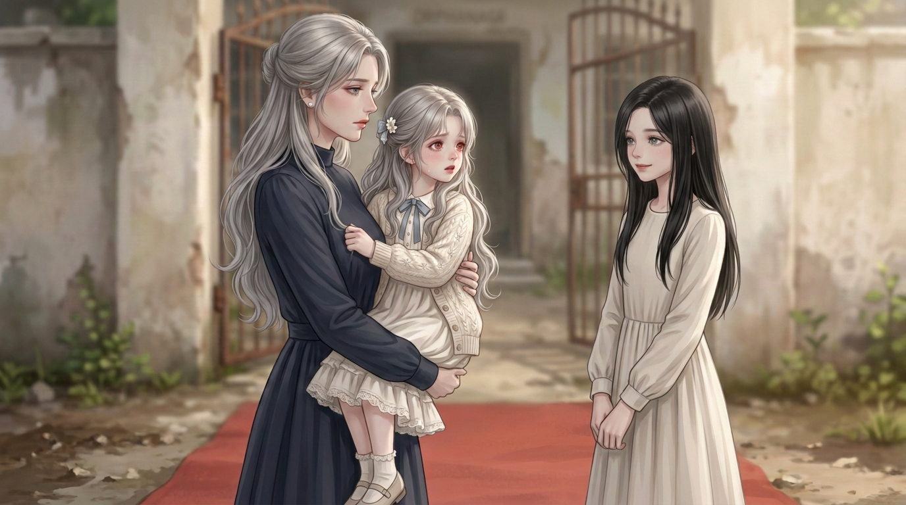

> **最新贴字要求已变更。** 原无字图/人物与责任继续有效；旧姓名名签/实白字框或文字侧栏不采用。见[当前贴字规范](../../../../贴字规范.md)。

# 童年首批：孤儿院重生的两格原图

2026-10-25｜首话 PAGE-008–009原图素材｜**两格已生成，画风已获创作者认可；已组为第8–9页局部实图试排，仍非完整首话验收。**

这批只画童年；青年、成年仍由创作者生成。沿旧档的童年画风与外貌做图，服装按同一场戏统一，不借换衣服重设计脸、发色、瞳色或基础发型。

## 第一格：在母亲怀中醒来

苏梨睁眼认出母亲，攥住母亲衣服；地点是孤儿院门口，不是病床。

原图：`PANEL-008-01-v3.png`，1376×768，RGB静态PNG，无对白/旁白贴字。

## 第二格：母亲介绍秦音

母亲仍抱着苏梨，向她介绍秦音。苏梨九岁、秦音十二岁；这一格不宣布收养或取消收养已经完成。

原图：`PANEL-008-02-v2.png`，1376×768，RGB静态PNG，无对白/旁白贴字。

## 本批锁定与修正

| 人物 | 沿用旧档的识别特征 |
|---|---|
| 苏梨 | 幼年脸型，银灰长波浪发、红宝石色眼睛；米白开衫/棉裙、小蓝领结，同场连续 |
| 姜月烟 | 成年母亲的脸型，银灰半扎长发、灰色眼睛、珍珠耳饰、深蓝高领长袖裙 |
| 秦音 | 较年长的学龄女孩，黑色侧分长直发、灰蓝眼睛、浅色素裙；不是齐刘海 |

- 最终以[旧童年苏梨主参考](参考/REF-SULI-CHILD.jpg)为身份/渲染锚；第二格接当前使用的第一格原图维持母女和场景连续。
- 首格曾出现偏平、带字的草稿，未采用；第二格曾把秦音画成齐刘海，已据[旧正片脸部裁切](参考/REF-QINYIN-OLD-FACE.jpg)修回侧分。这里只展示当前使用的两张，不让创作者在不同画风废稿里挑。
- 自查了出场人数、发色/瞳色/发型、母亲两格都抱着苏梨、同一场景/服装、无系统界面或多余男孩。创作者已反馈“画风可以”，本批画风方向认可；不推定全部人物/剧情或整页已验收，机械文件检查也不能代替实图阅读检查。

## 接下来

最终一张发布图可以有多个镜头；本批两张独立原图只是组页素材，不决定每张各占一页。普通段落一页多镜，单镜独幅/大幅通常用于转折，格数与布局随剧情和字量调整，不固定双横格/等大网格。

当前已完成[第8–9页局部实图试排](../../制作成果/实图试排-v3/看图说明.md)，重生独幅、介绍/反应多镜与推广尾栏；对白/内心/旁白仍从[唯一分镜](../../漫画分镜.md)读取，保留可见姓名/类型标签，不缩字挤脸。本页展示的两张仍是原图；成页见上述链接，不是完整首话。旧原图名PANEL-008-02-v2现绑定PANEL-009-01，反应裁切另绑定009-02，原文件不重命名。

[完整生成记录与当前提示词](生成记录.md) · [来源、哈希与调用记录](生成来源.json) · [成年四格交接](../核对与制作单.md)
