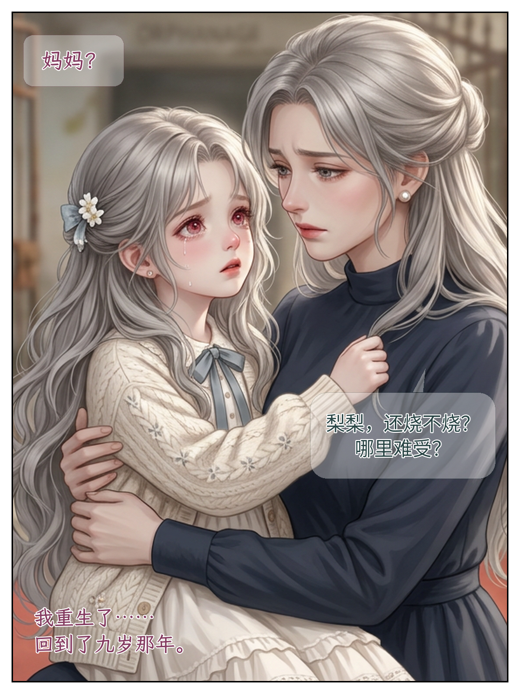
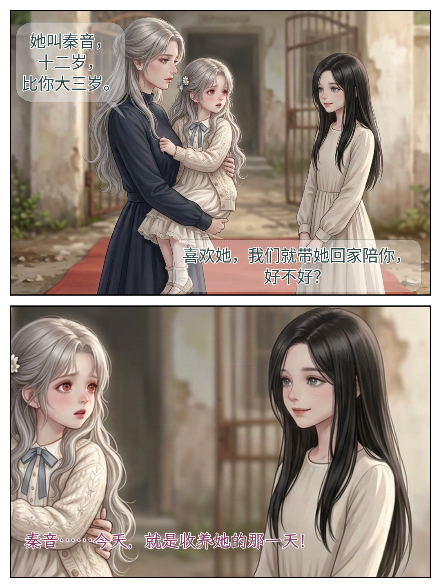

# 第8–9页：画内贴字新版

2026-10-25｜按最新反馈重做，**这两页是局部试排，尚待看图反馈，不是整话/平台验收**。

## 第8页：妈妈？

原文L152“妈妈？”与母亲关怀保留；L162人物认知转为苏梨内心。不再有“旁白｜第三人称”讲解框，字嵌在原画里。

## 第9页：收养提议与苏梨内心

母亲一句提议拆为两泡，合并文字与上一版完全一致；反应近景仍来自已认可同一原图，没有新增动作。取消文字白带/侧栏及推广底栏，人物脸和攥衣动作仍可见。

## 本次调整与边界

- 不画姓名/对白/内心类别标签；分镜元数据仍保留身份/听众。自然台词里的“秦音”“梨梨”不删。
- 苏梨全部对白/内心用酒红霞鹜文楷，霍谢山设深蓝粗宋全文；本段没有他发言，不造台词展示。母亲灰绿黑体，框形/字色/位置协同。
- 气泡底约34.5%不透明，正文100%不透明＋浅描边；不是把字也淡掉。正文40–44px，自然短语用源字符断点，不缩字。
- 原著有叙述，不等于必须配漫画旁白；本段用已有对白/人物认知说故事，没有新增解说。三话搜书卡改放各自发布文案，不占故事格。
- 两张1080×1440 RGB PNG，无新图像生成调用；只改裁切/贴字，画风/脸没有重绘。实际看两页及360宽近似缩览，后者不是手机或抖音/小红书实测。
- 原v3标签/白区方案已被反馈否决，只留历史；本轮不重新问已认可画风，也不把新贴字自动标为用户验收。

[唯一分镜](../../漫画分镜.md) · [实际排版](../../排版.json) · [试排来源/哈希](试排来源.json) · [画外发布文案](../../发布文案.md) · [贴字规范](../../../../贴字规范.md) · [旧档贴字参考](../../../../贴字参考/来源.json)
