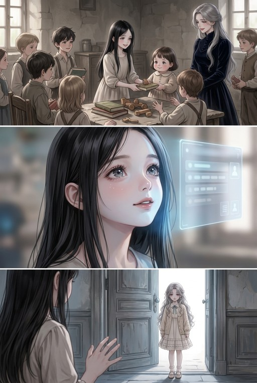

# 第002话开头：旧图核对与下一小批任务

2026-10-25｜**A已完成：先审图、列任务。本轮没有调用生图模型，没有生成第二话成页。**

[回漫画入口](../../../../README.md) · [唯一分镜](../../漫画分镜.md) · [三格完整提示词TXT](童年三格完整提示词.txt) · [来源/裁切/任务及哈希](来源与任务.json)

## 先看结论

本次只处理前两页的**5个镜头**：3项待确认童年制作（1改图、2新补），1张可继续排版核对的旧图局部，1格前世回忆待核年龄阶段。不是5格已完成，更不是两页成品。

| 当前格 | 实看/来源结论 | 处置与责任 |
|---|---|---|
| 001-01：回答母亲 | 首话已认可母女图能锁脸/抱姿/衣服，但仍是惊醒与担忧，不用同一表情冒充乖巧答应；旧P1是床上，场景错误 | 助手改图1项，接成抬头回答，仍抱着、不改脸与画风 |
| 001-02：前世背弃 | 原文L180未给此回忆的具体年龄，旧提示词误带当前九岁/十二岁年龄串 | 已撤去误套年龄；暂不放进童年批，也不擅自指派青年任务。先确认造型阶段，正文保留 |
| 002-01：分自己的零食 | 旧P2上格是室内、书本/积木，且未画抱着苏梨；不能当院内分零食的准确表现 | 助手新补1项；母亲仍抱苏梨，小孩接礼包的接触点画清 |
| 002-02：秦音问系统 | 旧P2中格仰望，带界面；不满足本格低垂眼睫/院内孩子背景 | 助手新补1项，不让旁人看到/听到系统 |
| 002-03：系统回应 | 旧P2中格的秦音脸、侧分发型、灰蓝眼与冷光可用；界面不必保留 | 已裁552×460候选素材，未改像素、未绑定候选布局；图齐后按真图另核版式 |

## 实际复用候选（不是新生图）

原图裁切坐标为`[16,424,568,884]`（左上含、右下不含），去掉实体感UI，同时保留两眼、鼻尖和下颌轮廓。首试框右侧太紧，已退缓存；这里只保留修正后的v2，不把两次本地裁切算模型调用。候选仅用于同一系统交流中的主观近景，不伪造新动作；姓名/系统私有性与完整回答仍从分镜后贴。

### 为什么旧整页不能直接用

上格场景/物件与新分镜不合，中格可提脸部局部，下格苏梨已单独站门口，不能拿来跳过收养回答与母亲放下女儿的过程。旧P1的床上重生也不复用。

本轮实看旧P1/旧P2、首话两张已选原图及局部裁切；旧页Git blob已核，不按文件名猜“无字”。没有审完全旧库，不宣称别处全无适合图；更后面的旧P3/P4不在本批实图结论里。

## 下一小批：3项，等本批明确确认

- **001-01｜改图**：旧童年111为主身份/渲染锚；首话母女独幅为改图底，三人场景只补服装/场地连续。只改回答所需表情/眼神，不换脸/发型/发色瞳色，不画惊醒大哭。
- **002-01｜新补**：院内，十二岁秦音递自己的零食给更小的孩子；母亲仍抱九岁苏梨。不能把旧图的书本/积木当零食。
- **002-02｜新补**：十二岁秦音低垂眼睫，现实暖光，内心询问系统；院内孩子弱虚化，不画实体投影或苏梨偷听。

完整提示词已写入[唯一分镜](../../漫画分镜.md)，TXT只是同源只读导出，来源JSON绑定当前源/上一话/参考/提示词SHA。修改先回源，不另改TXT。所有32个TEXT正文均与本轮前一致；本话12页/28格/32文字块不变。

**参数与费用边界**：逐项单格无字静态PNG，请求横向约16:9，最终按实际尺寸记录；不是整页多格出图或新画风探索。具体底层型号/seed不可预先保证，工具未提供报价，费用未知，不虚报免费；3项目标不等于保证只调用3次。确认前本轮模型调用为0，青年/成年仍由创作者生成，童年场中的成年母亲仍由助手处理。

## 衔接与成页仍欠什么

- 真正入口仍接首话第9页的收养提议：先“回答”，不是已收养、已知系统或突然换到室内。
- 分镜中的前世回忆必须保留，未定年龄不等于删格/跳过。原文没有准确年龄，后续应明确是创作者的造型表现选择，不伪称考据出的事实。
- 问系统与系统答都只对秦音开放；保留“承诺”性质，不提前画所有人真已爱上她。
- 当前排版JSON尚未按真图重排，三格新图和回忆都未齐。候选局部不能按984×432默认裁切就假称成品：先试完整脸、字区和名签，必要时用侧栏/改格高，普通多镜不套固定网格。
- 只有所选整页全部素材就位后才用真实CH002与`--previous`指向CH001执行局部preview；正式全话render仍必须齐图。不是独立审查、手机/平台或发布通过。

依据：[原著2章L174–244](../../../../../阴湿小狗不语，只一味装乖绿茶%20-%20三月清梦.txt#L174-L244)，旧固定提交`cf408fb5a7d573826f0da4e0a3ef4ac51bddb9f1`，详细Git blob、当前源和本地资产SHA见来源JSON。原著与旧图权利/准确阅读入口仍待核验。
