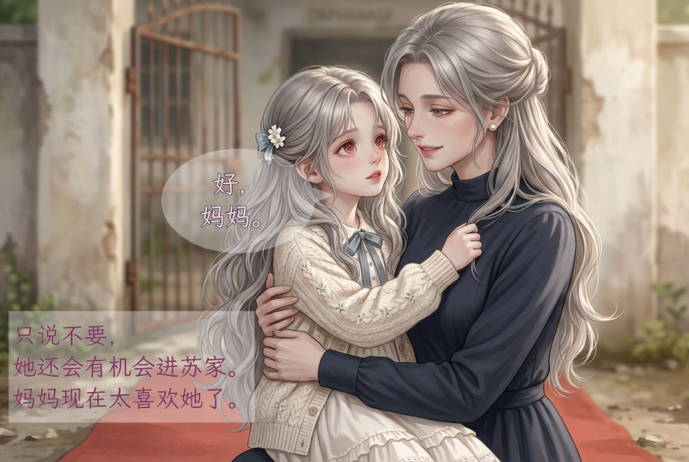

# 第二话童年首批｜三项已出图，第2页已贴字

2026-10-25｜创作者选C并明确“先把童年剧本相关写好了，直接出图”。先核原文、唯一分镜与上话交接，再执行已定三项，不重复卡在待确认；不是自动扩成全量童年或成年新图。

## 第2页：分零食与私有系统问答


- 1080×1440 RGB；上格分自己的零食、中格秦音询问、下格仅她可闻的系统承诺。原有三块正文完整，不加姓名/类别标签；没有让苏梨知道系统，也没有把系统承诺写成已发生的事实。
- 页内三格高度480/315/639px，外边与格框0，两处白分隔均3px，不套三等格。取景留住递交饼干、打开的自有礼包、母亲抱持与眼/鼻/下颌；低细节区承载轻椭圆/矩形，不另开白字带。
- 秦音对白浅紫＋1px深细描边、内心深紫无描边；系统用蓝灰矩形脑内声。正文34px，完整短语用源字符断点，不自动缩字或复制正文进排版JSON。
- 第2页为局部成页自检，不等于第二话12页已齐图、连续前两页完成或平台验收。唯一源原有“先行为后揭暗线”的表现次序已说明：原文系统问答在分自己那包之前，漫画此处不是逐格逐时序复刻。

## 第1页仅首格：表面答应，内心防备



984×660是**PANEL-001-01局部**，不是完整PAGE-001。苏梨原对白/内心全部用霞鹜文楷Medium，36/34px；短尾靠女儿脸侧，不横穿头发指给母亲，内心矩形缩紧但保全句。母亲仍稳抱着她，没有突然放地。

本页另一格是前世背弃回忆，原文未给三人具体年龄，造型阶段/制作责任仍待核；不能删掉动机或直接套九岁/十二岁来凑页。页级preview和全话media仍在该缺图处拒绝。

## 本轮实际生图与来源

三项共**3次图像调用、0重试、0未采用**；三张均1376×768 RGB无字PNG，沿已认可旧童年人物/画风：

1. [回答母亲原图](../格图/PANEL-001-01.png)：沿已选母女图改回应表情，衣服/脸/抱姿/场景连续。
2. [分自己的零食原图](../格图/PANEL-002-01.png)：秦音托着拆开的自有礼包，把其中一小包饼干递给更小孩子；母亲仍抱苏梨。
3. [秦音问系统原图](../格图/PANEL-002-02.png)：侧分长黑发/灰蓝眼/素裙，低垂眼睫、闭口内心；无实体UI，背景只是院内孩子。

系统回应格复用前轮552×460去界面脸部裁切，原字节不改，不算新生图。童年历史合计8次模型调用（前批5＋本批3）；5张生成图选用、前批3张未采用，本批没有未采用稿。底层型号/seed/报价未返回，不虚报免费或账单。

[本批生成收据](../../出图交接/第二话首批/生成来源.json)记实际提示词SHA、输入参考顺序/哈希及图像尺寸/SHA；[排字来源](试排来源.json)保当前布局快照/字体/输入输出，首格另有[局部范围收据](首格局部/来源.json)。生图统计与本地排字操作分开，不能把本地步骤“未调用模型”误写成整轮0次。

## 检查边界与复现

已看3张原图、两张排字实图与360宽软件近似缩览；关键脸/手/递交与字框外像素另与同取景底图比较，具体区域在排字收据。这是创作自检，不是独立审查、真手机或抖音/小红书验收；不重问已认可画风，也不冒称创作者已认可这批全部细节。

本轮31块正文/类型/人物归属与事件ID不改；仅细化三项提示词、已拆自有零食动作及暗线揭示的时序说明。其余四份分镜、首话旧图/成人首格与童年v4/v5输出不改。成年四图仍等创作者，未生成青年成年新图、未上传平台。

本次Python3.11 / Pillow11.3.0；字体按`漫画改编/字体来源.json`固定blob恢复，二进制不入Git。复现用新目录：

```bash
python3 skills/static-comic/scripts/comic_tool.py preview \
  漫画改编/开篇修订/第002话/排版.json \
  --previous 漫画改编/开篇修订/第001话/漫画分镜.md \
  --page PAGE-002 \
  --font "$HOME/.cache/drama-tools/NotoSansCJKsc-Regular.otf" \
  --speaker-font "苏梨=$HOME/.cache/drama-tools/LXGWWenKai-Medium.ttf" \
  --speaker-font "霍谢山=$HOME/.cache/drama-tools/NotoSerifCJKsc-Bold.otf" \
  --out /tmp/ch2-page2-check-new
```

首格可用项目`复现单格.py`，明确`--panel PANEL-001-01`、同一`--previous`与苏梨文楷参数；它不冒充完整页。源码/布局/字体/Pillow不同版本都须重新核像素与SHA。

[唯一分镜](../../漫画分镜.md) · [实际排版](../../排版.json) · [本批制作单](../../出图交接/第二话首批/核对与制作单.md) · [漫画入口](../../../../README.md)
