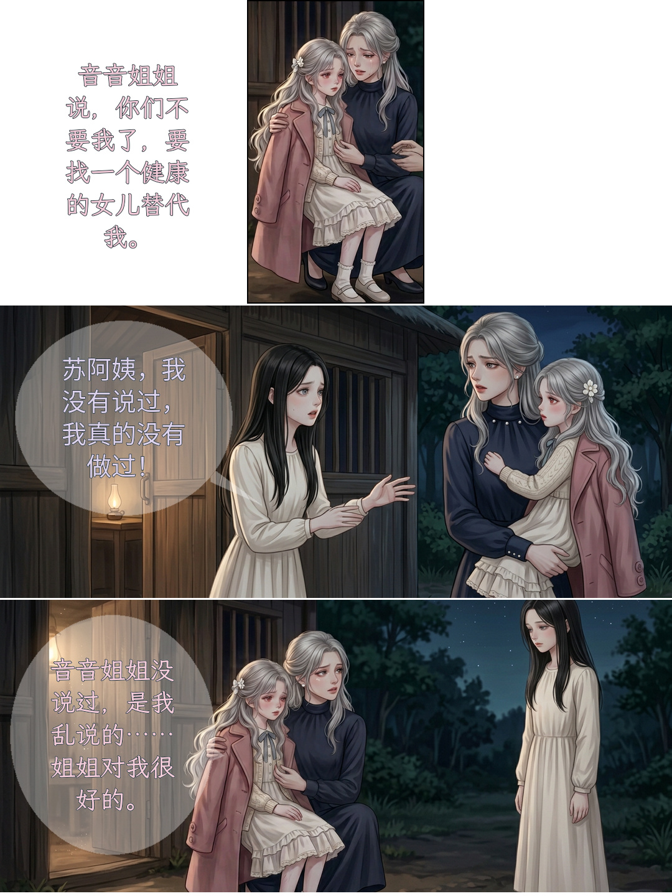
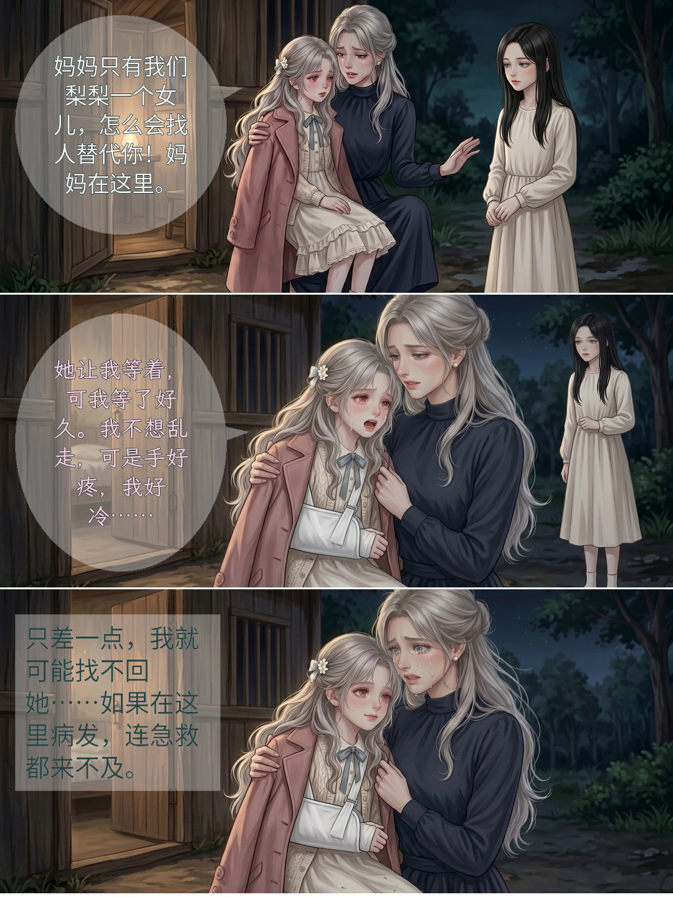
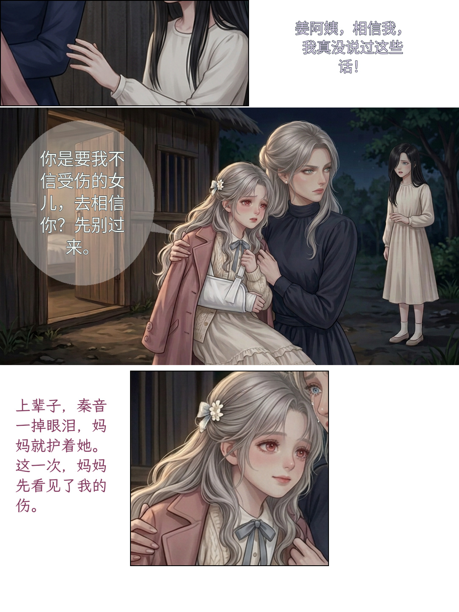
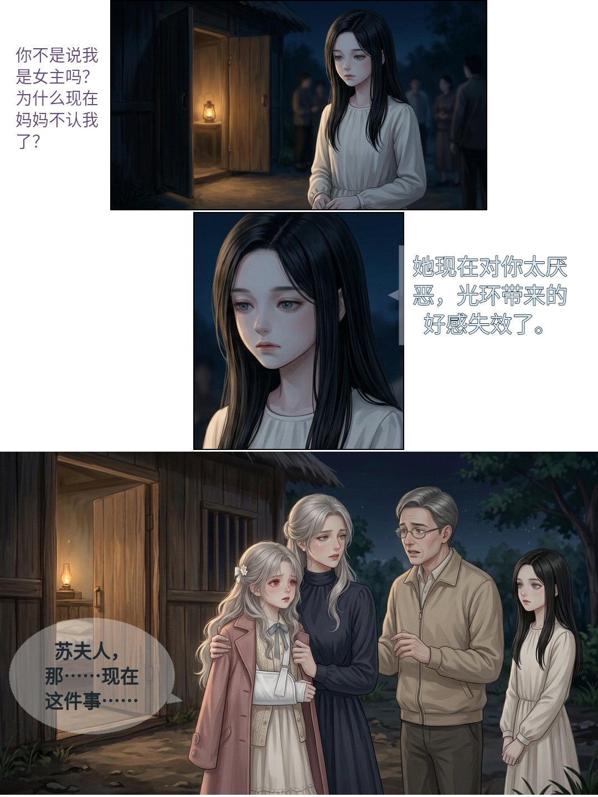
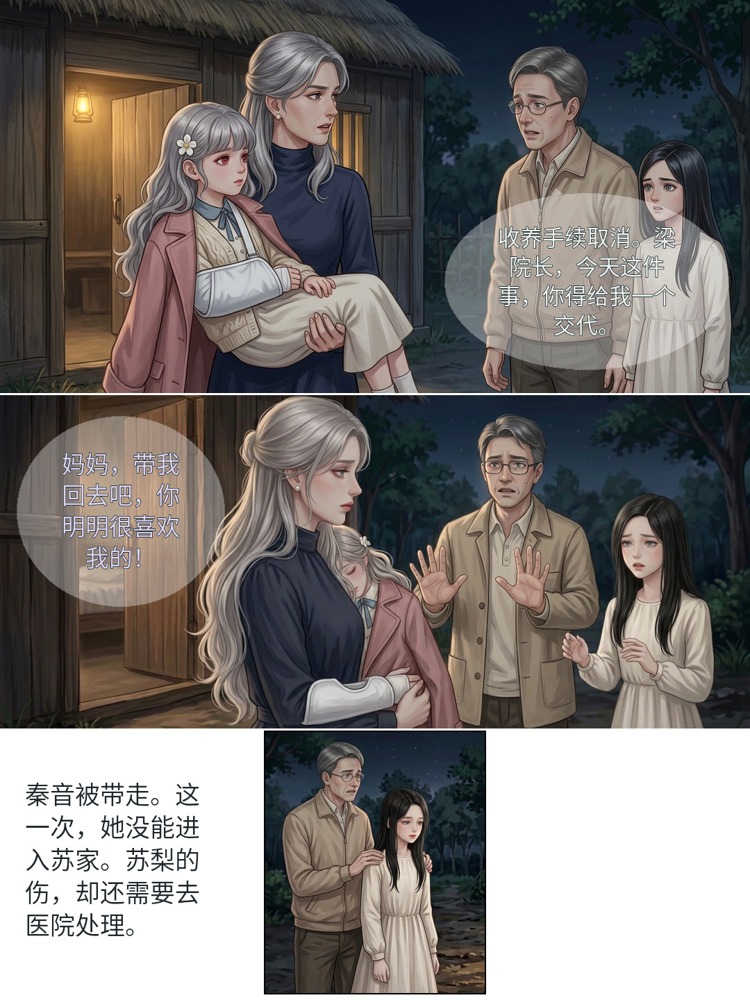
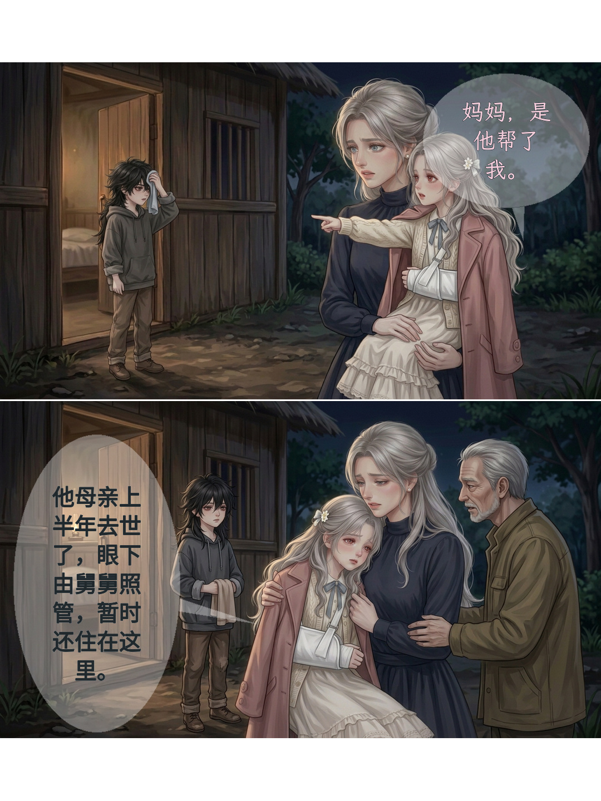
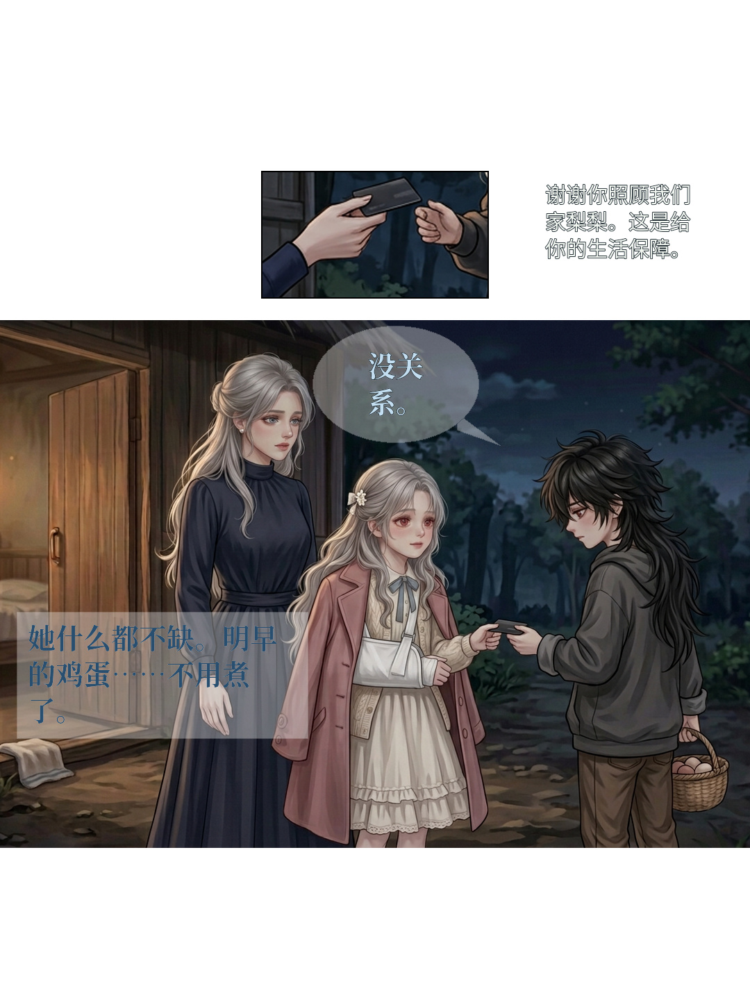
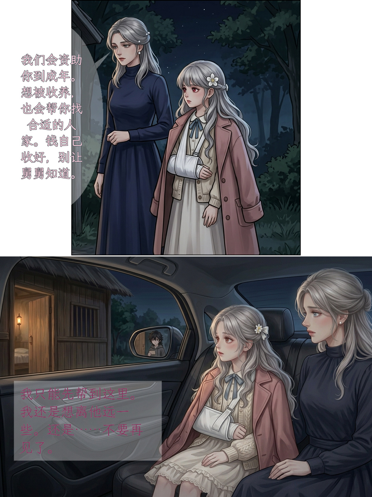

# 第003话 画内贴字 v5 看图说明（8页全话）

日期：2026-10-25（沙箱执行日）　状态：rendered（全话8页媒体齐备后的正式渲染，非 preview）
回执：同目录 `试排来源.json`（含排版快照、字体 blob、输出 SHA、保护区几何核对）

## 页面

| 页 | 图 | 内容要点 |
|---|---|---|
| 1 |  | 苏梨复述秦音诬告话／秦音否认／苏梨自认乱说；插入条=孤儿院门口拥抱 |
| 2 |  | 母亲安抚“妈妈在这里”／苏梨哭诉等不到人／母亲后怕旁白 |
| 3 |  | 袖口手未碰证据条／母亲冷拒“先别过来”／苏梨内心“妈妈先看见了我的伤” |
| 4 |  | 秦音内心女主光环失效／系统矩形提示／来人结巴开口（左门区气泡+右向尾） |
| 5 |  | 父亲取消收养要交代／苏梨求母亲带她回去（左区无尾气泡，护脸护掌）／旁白秦音被带走 |
| 6 |  | 苏梨指认“是他帮了我”／母亲说明男孩身世（左区气泡，护后视镜反射） |
| 7 |  | 生活费卡交接插入条（1.6×上限内）／男孩“没关系”／男孩内心鸡蛋不用煮（左下矩形） |
| 8 |  | 母亲资助承诺（左列高气泡）／苏梨车内内心“不要再见了”（左下矩形，后视镜清晰） |

## 延续性与边界

- 正文/类型/归属零改动：22 块文字逐字来自 `../漫画分镜.md`（sha 见回执），事件ID未动。
- 与第002话交接：本页组首格延续 CH002 末尾孤儿院门口夜景；CH002 第1页仍缺 `PANEL-001-02`，故“001→002→003”连续阅读仍受阻，本回执只证明 CH003 自身8页可连续看。
- 字体：叙述/系统/他人=Noto Sans CJK SC Regular；苏梨台词/内心=LXGW WenKai Medium；霍谢山=Noto Serif CJK SC Bold（blob 见回执与 `../../../漫画改编/字体来源.json`）。
- 画内嵌字：无独立白条字幕、无可见名签；气泡半透明（opacity 88）、文字不透明、细描边。

## 保护与妥协（创作者复核点）

- 已护：全部脸部皮肤区、母亲托抱手、拒掌、卡片交接手、鸡蛋篮、PAGE-008 后视镜男孩反射——贴字矩形与这些区域零相交（回执 `pixel_checks.violations` 为空），尾巴尖另经全分辨率目视。
- 几何边界：插入条按 ≤1.6× 显示、满幅行裁切 ≤25%（CMC-29/30 边界，测试回归钉住）。
- 妥协1（白边浮字）：插入条行（P1行1、P3行1/行3、P4行1/行2、P5行3、P7行1）的台词/内心落在白边上，半透明白气泡在白底不可见，呈“浮字+角色色”形态；归属靠角色色与邻近格序，插入条本身不被遮。
- 妥协2：P5行2 苏梨求带走的台词放左门区且无尾（右侧全是脸与拒掌），靠角色色+阅读顺序归属。
- 妥协3：P4行3、P7行2 内心矩形离说话人较远（护脸/护卡换手），尾向或颜色承担归属；P7行1 无尾。
- P3/P6/P7 的上下白边为测量后的居中留白（统一审图记录已列，回执 white_rows 明细），非裁图失败。

## 复现

```
comic_tool.py render 漫画改编/开篇修订/第003话/排版.json \
  --previous 漫画改编/开篇修订/第002话/漫画分镜.md \
  --font <NotoSansCJKsc-Regular.otf> --speaker-font 苏梨=<LXGWWenKai-Medium.ttf> \
  --speaker-font 霍谢山=<NotoSerifCJKsc-Bold.otf> \
  --out 漫画改编/开篇修订/第003话/制作成果/画内贴字-v5 --format jpg
```

来源：格图见 `../制作成果/格图/`（41_job 绑定见 `../../../连续童年出图/统一审图记录.md`）；生成收据 `../../../连续童年出图/来源与任务.json`。
验收边界：仅创作自检；非手机实看、非平台审核、非创作者最终验收。
