# 连续童年底图看图索引

2026-10-25｜本次既定CH002余20格＋CH003全21格，共41项**无字媒体素材已就位**。这不是整书/所有童年或漫画完稿。
**统一复核已完成一轮**：41格内容/身份/手/持物逐项实看通过，但当前候选排版几何会裁掉16.8–74.3%源画面或放大1.48–5.74倍，
组页前必须按 [统一审图记录](统一审图记录.md) 的显示建议改几何；测量见 [审图测量-round5.json](审图测量-round5.json)。

本轮10次出图全部有PNG：7整幅用、3只取准确局部，另2同场反应复用，新增12项从29→41。无本轮额外重试/新审核/容量拒绝，无新贴字页。

[本轮12格预览](第四轮底图预览.jpg) · [全部41格预览](底图进度预览.jpg) · [真实来源/调用/用途](来源与任务.json) · [本轮核对](第四轮核对.json) · [制作记录](制作记录.md)

## 原守夜请求与替代镜别

历史守夜双人床构图被工具拦截，无文件；这条记录仍是未交付，没有改成成功。当前任务使用**另一次已成功交付**的同场床边回应原稿里女主安静守候脸肩近景，只有既存无害像素，不接触未知被拦图、不重新请求/改写受拦构图、不新增躺姿或额头搭巾结果。原夜深留守/忘时叙述与男孩内心全部保留，男孩/换巾动作在画外由相邻真实病床回应承接；局部不能证明伤侧/额巾/持物。

## 采用的41格

| 格 | 取用方式 | 实际PNG |
|---|---|---|
| CH002/PANEL-004-01 | 生成整幅 | [1376×768 PNG](../开篇修订/第002话/制作成果/格图/PANEL-004-01.png) |
| CH002/PANEL-004-02 | 生成整幅 | [1376×768 PNG](../开篇修订/第002话/制作成果/格图/PANEL-004-02.png) |
| CH002/PANEL-004-03 | 生成整幅 | [1376×768 PNG](../开篇修订/第002话/制作成果/格图/PANEL-004-03.png) |
| CH002/PANEL-005-01 | 生成整幅 | [1376×768 PNG](../开篇修订/第002话/制作成果/格图/PANEL-005-01.png) |
| CH002/PANEL-005-02 | 生成整幅 | [1376×768 PNG](../开篇修订/第002话/制作成果/格图/PANEL-005-02.png) |
| CH002/PANEL-006-01 | 生成整幅 | [1376×768 PNG](../开篇修订/第002话/制作成果/格图/PANEL-006-01.png) |
| CH002/PANEL-006-02 | 生成整幅 | [1376×768 PNG](../开篇修订/第002话/制作成果/格图/PANEL-006-02.png) |
| CH002/PANEL-007-01 | 生成稿准确局部 | [415×255 PNG](../开篇修订/第002话/制作成果/格图/PANEL-007-01-衣角细节.png) |
| CH002/PANEL-007-02 | 生成稿准确局部 | [490×345 PNG](../开篇修订/第002话/制作成果/格图/PANEL-007-02-回应近景.png) |
| CH002/PANEL-008-01 | 生成整幅 | [1376×768 PNG](../开篇修订/第002话/制作成果/格图/PANEL-008-01.png) |
| CH002/PANEL-008-02 | 生成整幅 | [1376×768 PNG](../开篇修订/第002话/制作成果/格图/PANEL-008-02.png) |
| CH002/PANEL-008-03 | 生成整幅 | [1376×768 PNG](../开篇修订/第002话/制作成果/格图/PANEL-008-03.png) |
| CH002/PANEL-009-01 | 裁切＋局部校色 | [380×185 PNG](../开篇修订/第002话/制作成果/格图/PANEL-009-01-软芯递交.png) |
| CH002/PANEL-009-02 | 生成整幅 | [1376×768 PNG](../开篇修订/第002话/制作成果/格图/PANEL-009-02.png) |
| CH002/PANEL-010-01 | 生成整幅 | [1376×768 PNG](../开篇修订/第002话/制作成果/格图/PANEL-010-01.png) |
| CH002/PANEL-010-02 | 生成稿准确局部 | [360×280 PNG](../开篇修订/第002话/制作成果/格图/PANEL-010-02-触头近景.png) |
| CH002/PANEL-011-01 | 允许同场反应复用 | [320×240 PNG](../开篇修订/第002话/制作成果/格图/PANEL-011-01-守候反应近景.png) |
| CH002/PANEL-011-02 | 生成稿准确局部 | [330×300 PNG](../开篇修订/第002话/制作成果/格图/PANEL-011-02-床边回应近景.png) |
| CH002/PANEL-012-01 | 生成整幅 | [1376×768 PNG](../开篇修订/第002话/制作成果/格图/PANEL-012-01.png) |
| CH002/PANEL-012-02 | 生成整幅 | [1376×768 PNG](../开篇修订/第002话/制作成果/格图/PANEL-012-02-v2.png) |
| CH003/PANEL-001-01 | 生成稿准确局部 | [345×590 PNG](../开篇修订/第003话/制作成果/格图/PANEL-001-01-母女指控近景.png) |
| CH003/PANEL-001-02 | 生成整幅 | [1376×768 PNG](../开篇修订/第003话/制作成果/格图/PANEL-001-02.png) |
| CH003/PANEL-001-03 | 生成整幅 | [1376×768 PNG](../开篇修订/第003话/制作成果/格图/PANEL-001-03.png) |
| CH003/PANEL-002-01 | 生成整幅 | [1376×768 PNG](../开篇修订/第003话/制作成果/格图/PANEL-002-01.png) |
| CH003/PANEL-002-02 | 生成整幅 | [1376×768 PNG](../开篇修订/第003话/制作成果/格图/PANEL-002-02.png) |
| CH003/PANEL-002-03 | 生成整幅 | [1376×768 PNG](../开篇修订/第003话/制作成果/格图/PANEL-002-03.png) |
| CH003/PANEL-003-01 | 生成稿准确局部 | [375×160 PNG](../开篇修订/第003话/制作成果/格图/PANEL-003-01-袖口未接触细节.png) |
| CH003/PANEL-003-02 | 生成整幅 | [1376×768 PNG](../开篇修订/第003话/制作成果/格图/PANEL-003-02.png) |
| CH003/PANEL-003-03 | 允许同场反应复用 | [300×295 PNG](../开篇修订/第003话/制作成果/格图/PANEL-003-03-计划反应近景.png) |
| CH003/PANEL-004-01 | 生成整幅 | [1376×768 PNG](../开篇修订/第003话/制作成果/格图/PANEL-004-01.png) |
| CH003/PANEL-004-02 | 允许同场反应复用 | [350×395 PNG](../开篇修订/第003话/制作成果/格图/PANEL-004-02.png) |
| CH003/PANEL-004-03 | 生成整幅 | [1376×768 PNG](../开篇修订/第003话/制作成果/格图/PANEL-004-03.png) |
| CH003/PANEL-005-01 | 生成整幅 | [1376×768 PNG](../开篇修订/第003话/制作成果/格图/PANEL-005-01.png) |
| CH003/PANEL-005-02 | 生成整幅 | [1376×768 PNG](../开篇修订/第003话/制作成果/格图/PANEL-005-02.png) |
| CH003/PANEL-005-03 | 生成稿准确局部 | [560×665 PNG](../开篇修订/第003话/制作成果/格图/PANEL-005-03-院长带离近景.png) |
| CH003/PANEL-006-01 | 生成整幅 | [1376×768 PNG](../开篇修订/第003话/制作成果/格图/PANEL-006-01.png) |
| CH003/PANEL-006-02 | 生成整幅 | [1376×768 PNG](../开篇修订/第003话/制作成果/格图/PANEL-006-02.png) |
| CH003/PANEL-007-01 | 生成稿准确局部 | [205×115 PNG](../开篇修订/第003话/制作成果/格图/PANEL-007-01-递卡未接细节.png) |
| CH003/PANEL-007-02 | 生成整幅 | [1376×768 PNG](../开篇修订/第003话/制作成果/格图/PANEL-007-02.png) |
| CH003/PANEL-008-01 | 生成稿准确局部 | [666×740 PNG](../开篇修订/第003话/制作成果/格图/PANEL-008-01-资助交代近景.png) |
| CH003/PANEL-008-02 | 生成整幅 | [1376×768 PNG](../开篇修订/第003话/制作成果/格图/PANEL-008-02.png) |

## 本轮采用图

### CH002/PANEL-011-01
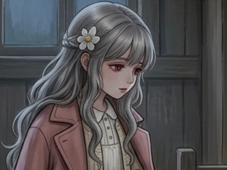

### CH003/PANEL-003-03
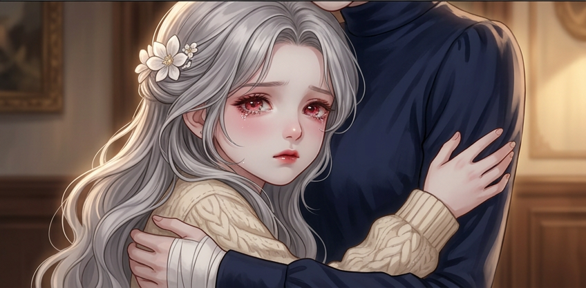

### CH003/PANEL-004-03
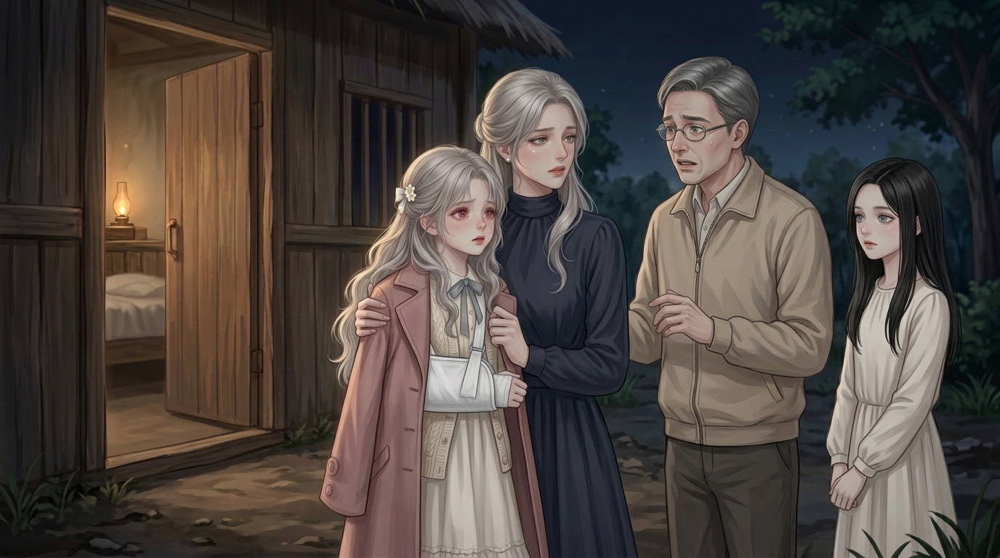

### CH003/PANEL-005-01
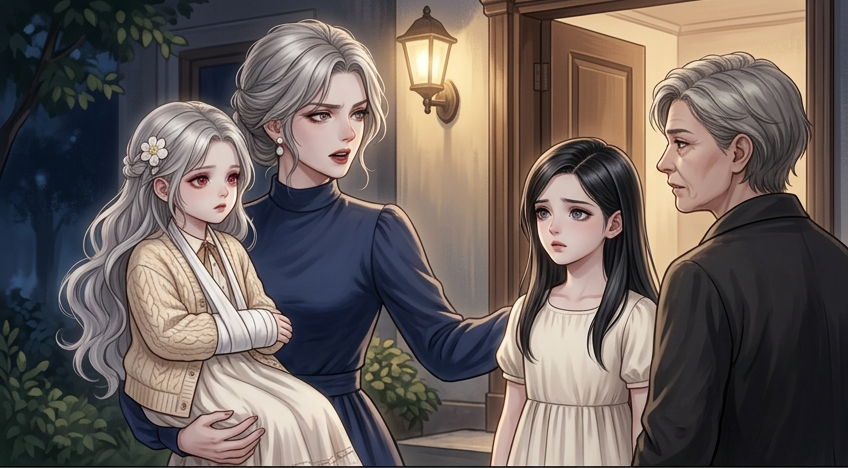

### CH003/PANEL-005-02
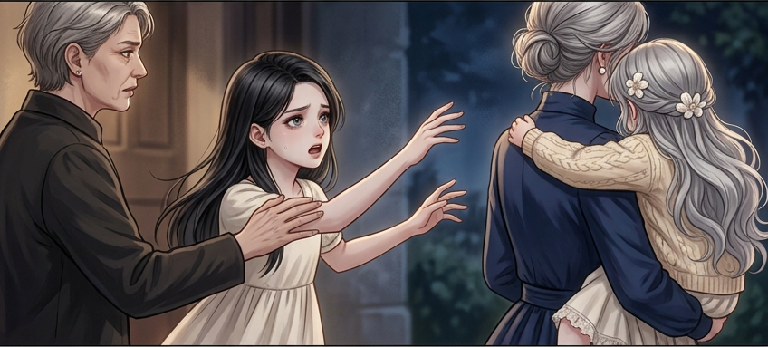

### CH003/PANEL-005-03
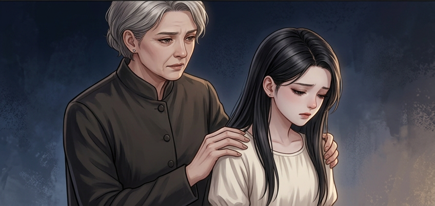

### CH003/PANEL-006-01
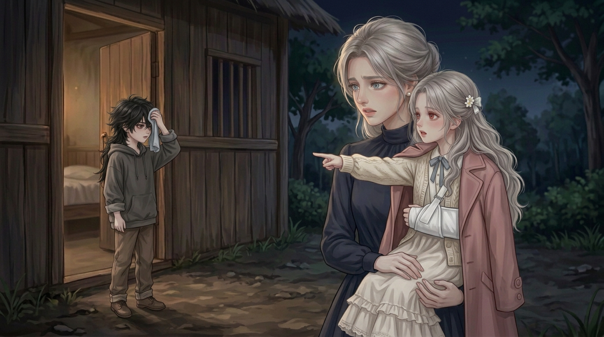

### CH003/PANEL-006-02
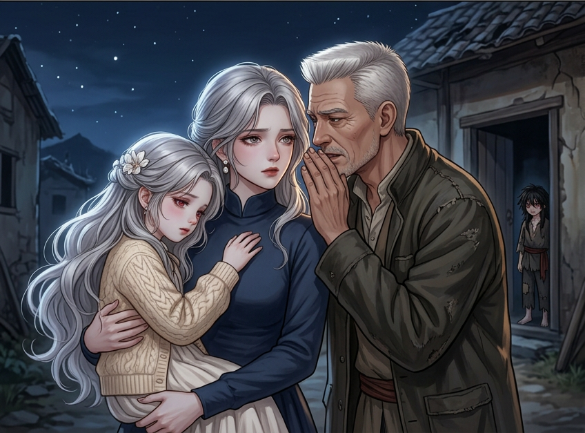

### CH003/PANEL-007-01
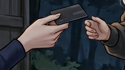

### CH003/PANEL-007-02
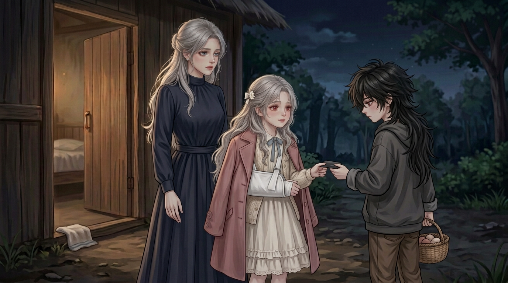

### CH003/PANEL-008-01
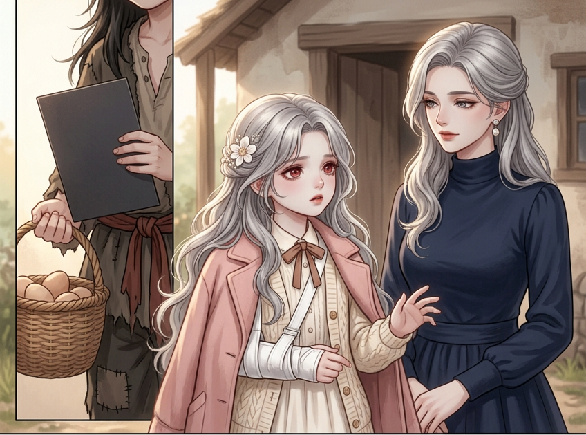

### CH003/PANEL-008-02
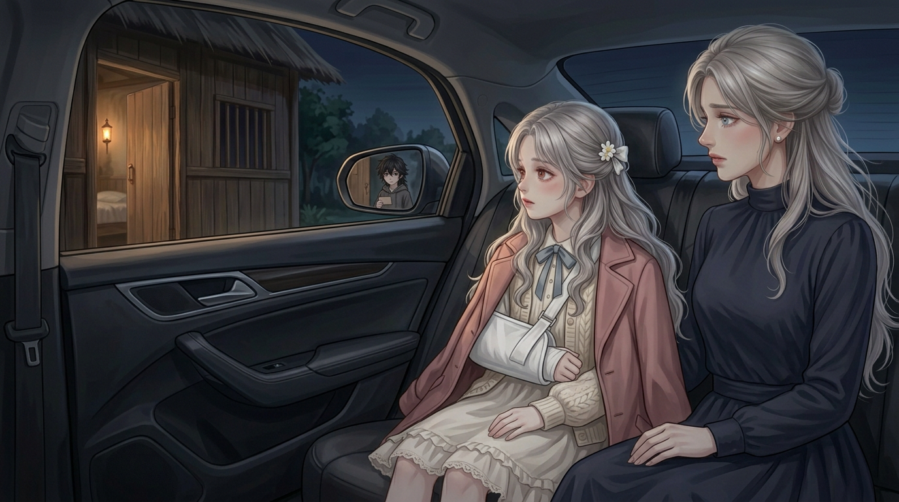

## 范围与下一步

- 这里完成的是现有连续开篇的41个明确童年缺图，不是全109章。CH002前世回忆001-02造型/责任未明、青年成年由创作者生成、中段局部补写未接整话仍单列。
- CH003全21格媒体可检查；CH002仍因前世回忆不能过整话媒体。文件存在不是人物/手/阅读/剧情、版权/实机/独立或平台验收。
- 原152块正文/身份/事件不改。当前镜别为取可用主体/动作可细化，源SHA/导出头更新，旧生成时SHA/调用/图文快照冻结。
- 新增院长/村长身份与物件锚限用途，手里的卡按真实抓持判归属：指卡不是再递一次；白支撑可横在抱持前，归孩子而非母亲新伤，连接细节待整体再核。
- 本轮递卡整图身份串换、带离整图女儿误站地、资助整图卡未清楚持续都没有拿整幅凑数，只取准确物件/人物局部，画外状态由前后镜承接但不声称局部证明它。
- 先图后字阶段已落盘，可转统一人物/物件/清晰度与镜位审查，再排页贴字；不自动开始平台发布或未授权新章节。
