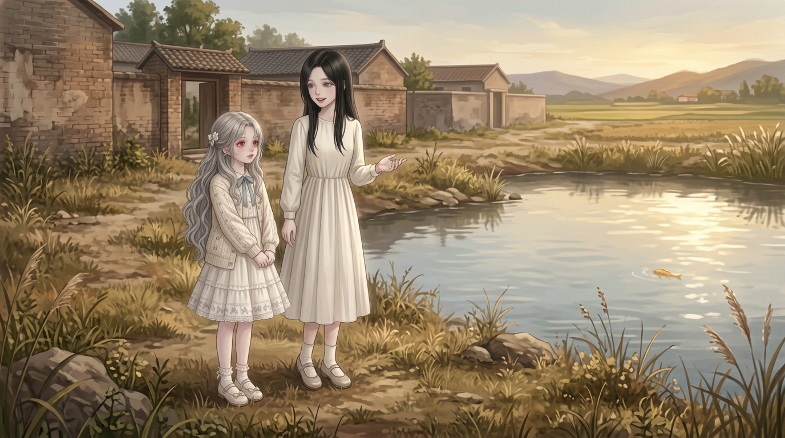
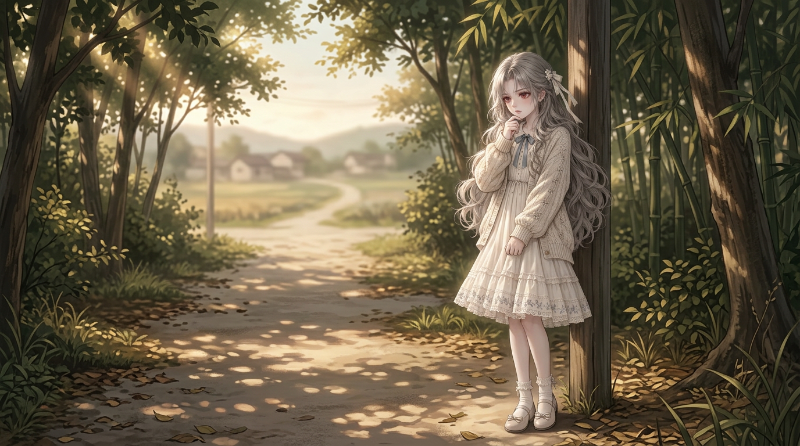
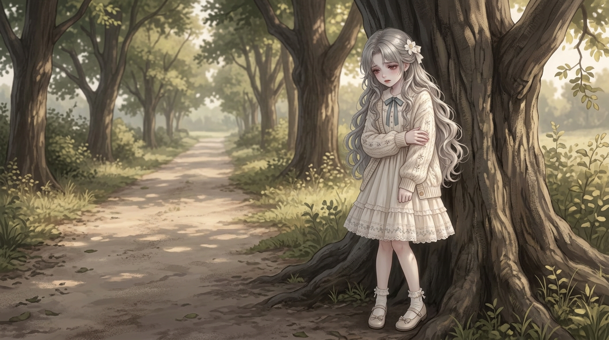
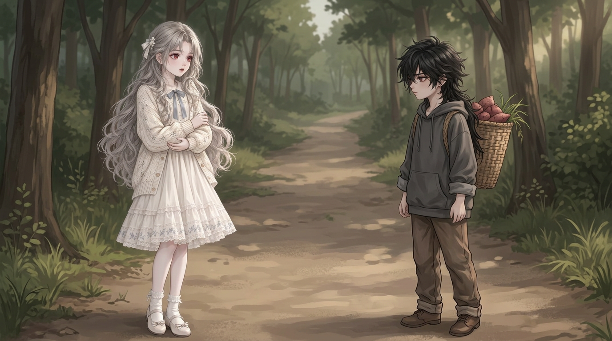
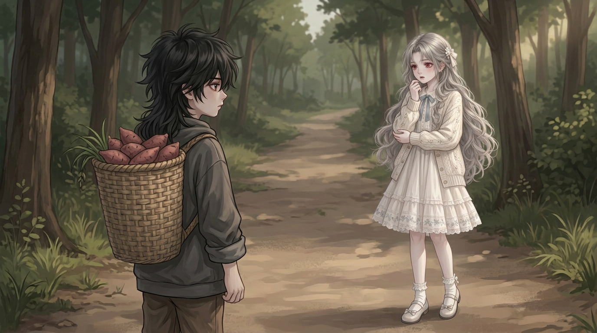
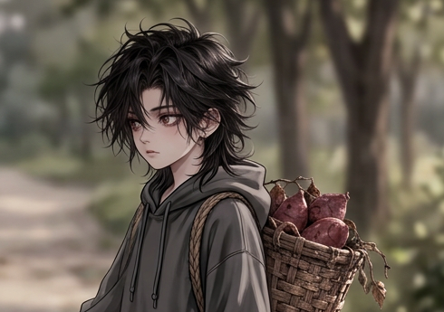
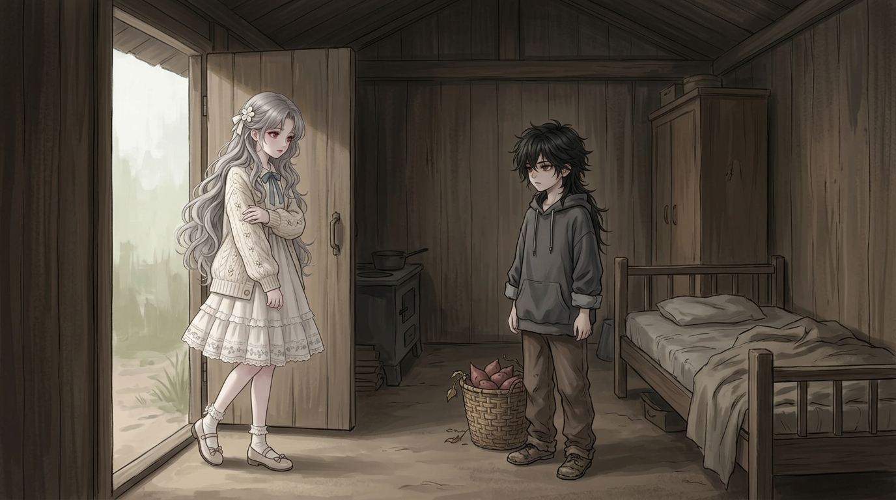

# 连续童年底图看图索引

2026-10-25｜按最新要求先补无字底图，不逐页排字、不逐页问开工。

**当前补齐10/41格，剩31格排队。** 本轮10次成功出图请求已到工具单轮上限，另3请求被限额直接拒绝，未产图。没有全部制作完，也没有漫画成页/平台验收。

[进度预览](底图进度预览.jpg) · [来源/完整队列](来源与任务.json) · [当前完整提示词只读导出](完整提示词.txt) · [制作记录](制作记录.md)

## 已就绪的10格

| 格 | 采用方式 | 文件 |
|---|---|---|
| CH002/PANEL-004-01 | 生成整图 | [1376×768 PNG](../开篇修订/第002话/制作成果/格图/PANEL-004-01.png) |
| CH002/PANEL-005-01 | 生成整图 | [1376×768 PNG](../开篇修订/第002话/制作成果/格图/PANEL-005-01.png) |
| CH002/PANEL-005-02 | 生成整图 | [1376×768 PNG](../开篇修订/第002话/制作成果/格图/PANEL-005-02.png) |
| CH002/PANEL-006-01 | 生成整图 | [1376×768 PNG](../开篇修订/第002话/制作成果/格图/PANEL-006-01.png) |
| CH002/PANEL-006-02 | 生成整图 | [1376×768 PNG](../开篇修订/第002话/制作成果/格图/PANEL-006-02.png) |
| CH002/PANEL-007-01 | 生成稿局部采用 | [415×255 PNG](../开篇修订/第002话/制作成果/格图/PANEL-007-01-衣角细节.png) |
| CH002/PANEL-007-02 | 生成稿局部采用 | [490×345 PNG](../开篇修订/第002话/制作成果/格图/PANEL-007-02-回应近景.png) |
| CH002/PANEL-008-01 | 生成整图 | [1376×768 PNG](../开篇修订/第002话/制作成果/格图/PANEL-008-01.png) |
| CH003/PANEL-004-01 | 生成整图 | [1376×768 PNG](../开篇修订/第003话/制作成果/格图/PANEL-004-01.png) |
| CH003/PANEL-004-02 | 同瞬间更近裁切 | [350×395 PNG](../开篇修订/第003话/制作成果/格图/PANEL-004-02.png) |

## 实际画面

### CH002/PANEL-004-01

### CH002/PANEL-005-01

### CH002/PANEL-005-02

### CH002/PANEL-006-01

### CH002/PANEL-006-02

### CH002/PANEL-007-01

### CH002/PANEL-007-02

### CH002/PANEL-008-01

### CH003/PANEL-004-01

### CH003/PANEL-004-02

## 续作顺序与未决

- 下一轮默认按同一授权续做，不需要重新确认每一页：先纠正夜里破屋外重逢，再补池塘指向/秦音暂离，之后进木屋披外衣/食物/发热/守夜，再接第三话夜里对质/取消收养/谢礼与告别。
- 当前工具限额只允许每轮10次出图；需新对话轮恢复容量，不能靠继续调用同一工具绕过。你发“继续”是恢复执行，不是重审批范围。
- 前世回忆CH002/001-02时期/责任仍未明、成年由创作者生成；中段补写未接成连续整话，另列，不冒称全109章/所有童年已完成。
- 先图后字只改变制作顺序，不删对白/旁白/动机。现有话头/事件/正文不改，只有当前图的镜别/提示词细化。
- 预览板只有格ID/状态，非故事字幕，不代表正式排版；旧第2–3页保持原样，不新增贴字页。
