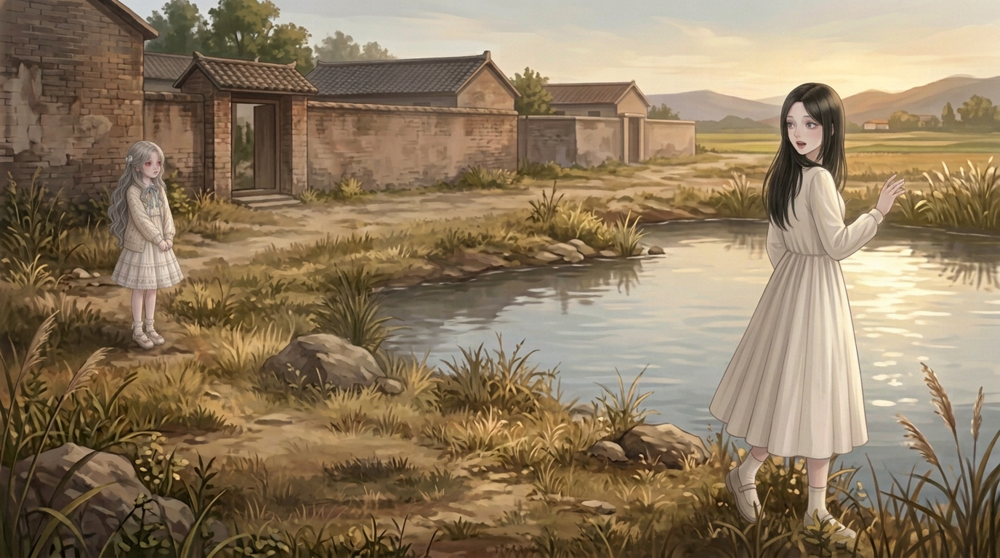
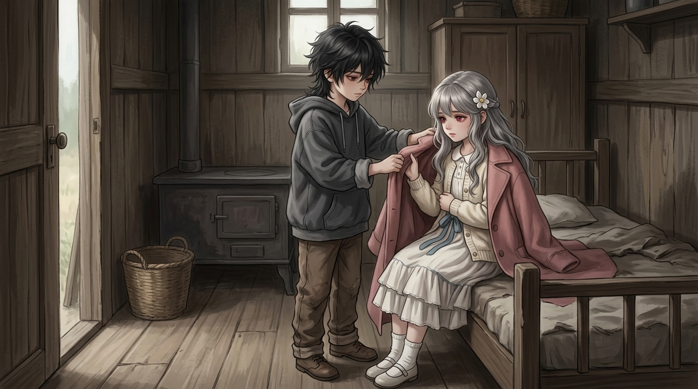
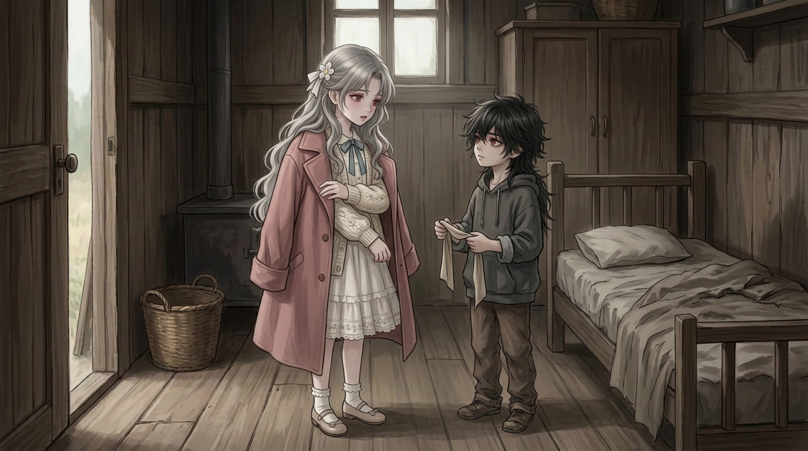
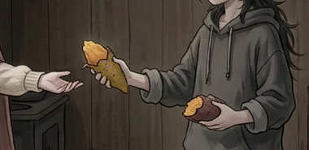
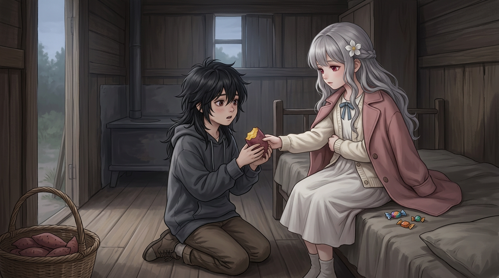
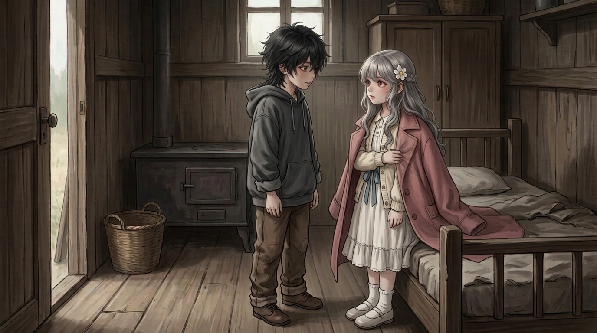
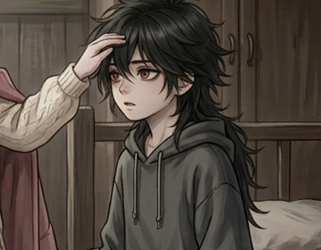
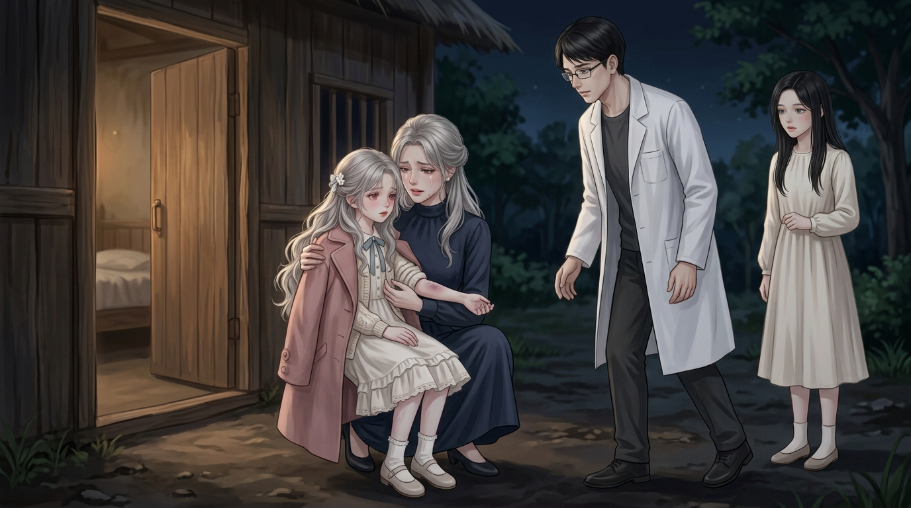

# 连续童年底图看图索引

2026-10-25｜先齐无字底图，后统一排字；沿原授权续作，不逐页审批。

**当前19/41格就绪，余22格。** 本轮10次请求有9张PNG、1次守夜审核拦截未保存；守夜不计完成，不推断其底层执行/费用。没有新发超预算或绕过审核请求。

[本轮9格预览](第二轮底图预览.jpg) · [全部19格预览](底图进度预览.jpg) · [源/调用/队列](来源与任务.json) · [续作说明](续作说明.md) · [制作记录](制作记录.md)

## 已就绪19格

| 格 | 取用方式 | 实际PNG |
|---|---|---|
| CH002/PANEL-004-01 | 生成整幅 | [1376×768](../开篇修订/第002话/制作成果/格图/PANEL-004-01.png) |
| CH002/PANEL-004-02 | 生成整幅 | [1376×768](../开篇修订/第002话/制作成果/格图/PANEL-004-02.png) |
| CH002/PANEL-004-03 | 生成整幅 | [1376×768](../开篇修订/第002话/制作成果/格图/PANEL-004-03.png) |
| CH002/PANEL-005-01 | 生成整幅 | [1376×768](../开篇修订/第002话/制作成果/格图/PANEL-005-01.png) |
| CH002/PANEL-005-02 | 生成整幅 | [1376×768](../开篇修订/第002话/制作成果/格图/PANEL-005-02.png) |
| CH002/PANEL-006-01 | 生成整幅 | [1376×768](../开篇修订/第002话/制作成果/格图/PANEL-006-01.png) |
| CH002/PANEL-006-02 | 生成整幅 | [1376×768](../开篇修订/第002话/制作成果/格图/PANEL-006-02.png) |
| CH002/PANEL-007-01 | 同瞬间局部裁图 | [415×255](../开篇修订/第002话/制作成果/格图/PANEL-007-01-衣角细节.png) |
| CH002/PANEL-007-02 | 同瞬间局部裁图 | [490×345](../开篇修订/第002话/制作成果/格图/PANEL-007-02-回应近景.png) |
| CH002/PANEL-008-01 | 生成整幅 | [1376×768](../开篇修订/第002话/制作成果/格图/PANEL-008-01.png) |
| CH002/PANEL-008-02 | 生成整幅 | [1376×768](../开篇修订/第002话/制作成果/格图/PANEL-008-02.png) |
| CH002/PANEL-008-03 | 生成整幅 | [1376×768](../开篇修订/第002话/制作成果/格图/PANEL-008-03.png) |
| CH002/PANEL-009-01 | 局部裁切＋物件校色 | [380×185](../开篇修订/第002话/制作成果/格图/PANEL-009-01-软芯递交.png) |
| CH002/PANEL-009-02 | 生成整幅 | [1376×768](../开篇修订/第002话/制作成果/格图/PANEL-009-02.png) |
| CH002/PANEL-010-01 | 生成整幅 | [1376×768](../开篇修订/第002话/制作成果/格图/PANEL-010-01.png) |
| CH002/PANEL-010-02 | 同瞬间局部裁图 | [360×280](../开篇修订/第002话/制作成果/格图/PANEL-010-02-触头近景.png) |
| CH002/PANEL-012-02 | 生成整幅 | [1376×768](../开篇修订/第002话/制作成果/格图/PANEL-012-02-v2.png) |
| CH003/PANEL-004-01 | 生成整幅 | [1376×768](../开篇修订/第003话/制作成果/格图/PANEL-004-01.png) |
| CH003/PANEL-004-02 | 同瞬间局部裁图 | [350×395](../开篇修订/第003话/制作成果/格图/PANEL-004-02.png) |

## 本轮实际画面

### CH002/PANEL-004-02

### CH002/PANEL-004-03

### CH002/PANEL-008-02

### CH002/PANEL-008-03

### CH002/PANEL-009-01

### CH002/PANEL-009-02

### CH002/PANEL-010-01

### CH002/PANEL-010-02

### CH002/PANEL-012-02

## 范围与继续方式

- 本轮9项：破屋外夜母纠正、池塘指向/秦音暂离、披衣/问秘密、红薯递交/分回糖果、互通名字/触头发现发热。
- 红薯递交及触头由整幅改准确局部：不宣称局部证明画外手侧。给她的薯芯有838像素手工色泽校正，有蒙版/参数；不是原像素不变。小蓝领结/缎带细节留统一后期复核，不据新图换全局衣装锚。
- 守夜011-01工具审核未保存，仍缺；不补占位、不说生图成功或故事违规，也没有本轮改字重试去绕过审核。
- 下一轮继续剩22格：先湿毛巾与搜寻，再接第三话母女对质、取消收养、谢礼/告别；守夜受拦项单列，不循环重试。新轮恢复容量不是重批范围，不承诺后台出图。
- 前世001-02造型/责任不明、成年由创作者负责、中段未接整话仍单列，不冒称整书全部童年完成。
- 旧已排字页与字体/几何不动，当前图齐只表示媒体文件就位，非完整话/手机平台/独立验收。
