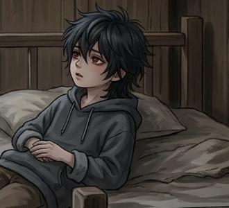
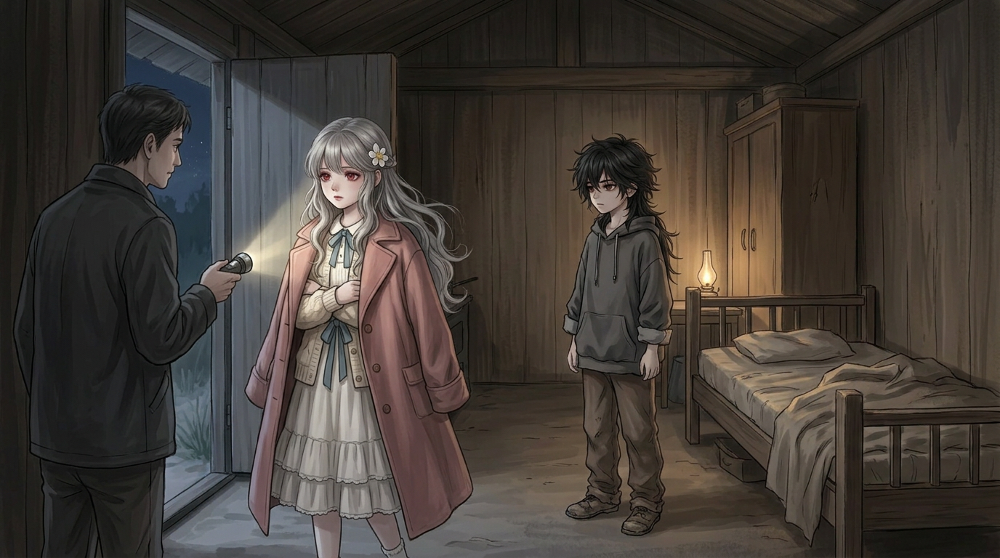
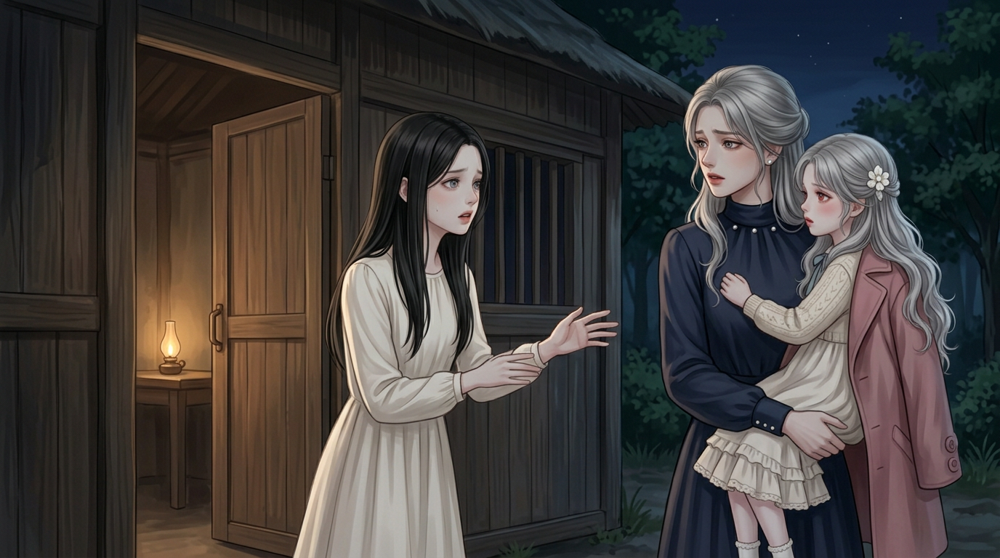
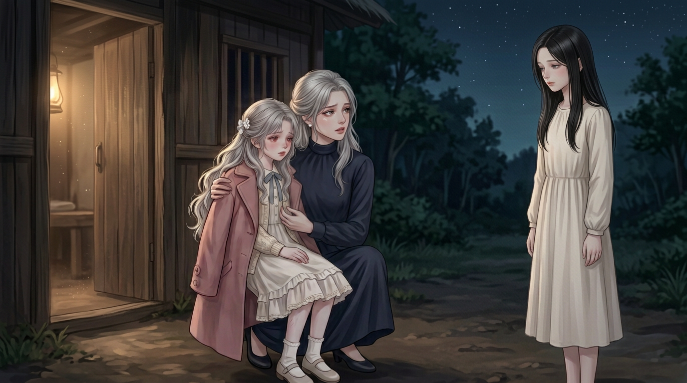
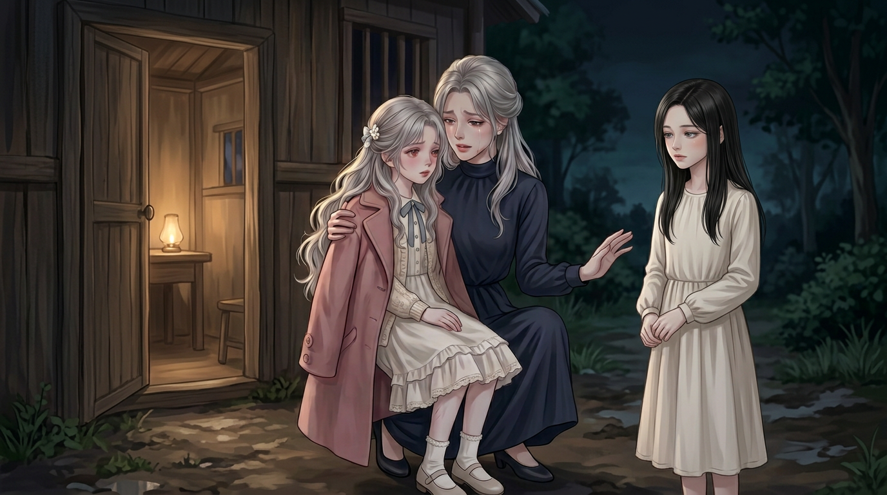
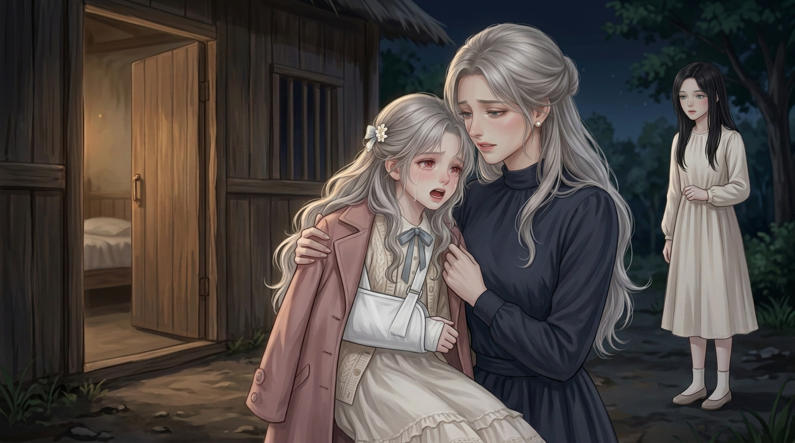
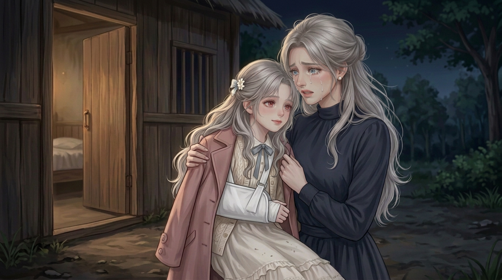
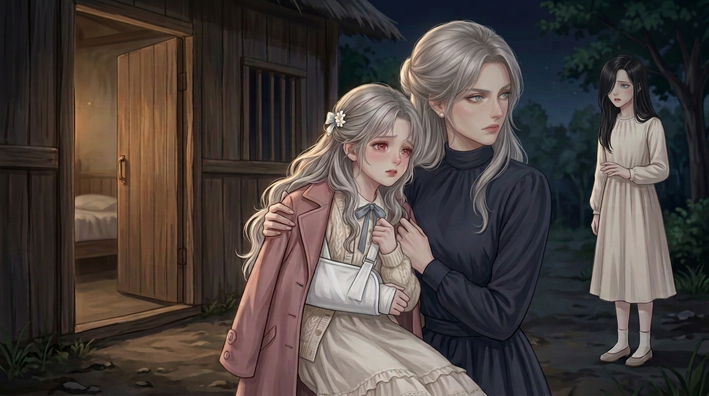

# 连续童年底图看图索引

2026-10-25｜按原授权先齐底图，不逐页审批/不排新文字页。

**当前29/41格就绪，余12格。** 本轮10次请求全部有PNG；7整幅采用、3只取准确局部。无本轮新限额拒绝/审核拦截/追加重试；历史守夜未交付项仍单列，尚未全部完成。

[本轮10格预览](第三轮底图预览.jpg) · [全部29格](底图进度预览.jpg) · [源/实际调用/待续](来源与任务.json) · [续作说明](续作说明.md) · [制作记录](制作记录.md)

## 全部已就绪素材

| 格 | 取用方式 | 实际PNG |
|---|---|---|
| CH002/PANEL-004-01 | 生成整幅 | [1376×768 PNG](../开篇修订/第002话/制作成果/格图/PANEL-004-01.png) |
| CH002/PANEL-004-02 | 生成整幅 | [1376×768 PNG](../开篇修订/第002话/制作成果/格图/PANEL-004-02.png) |
| CH002/PANEL-004-03 | 生成整幅 | [1376×768 PNG](../开篇修订/第002话/制作成果/格图/PANEL-004-03.png) |
| CH002/PANEL-005-01 | 生成整幅 | [1376×768 PNG](../开篇修订/第002话/制作成果/格图/PANEL-005-01.png) |
| CH002/PANEL-005-02 | 生成整幅 | [1376×768 PNG](../开篇修订/第002话/制作成果/格图/PANEL-005-02.png) |
| CH002/PANEL-006-01 | 生成整幅 | [1376×768 PNG](../开篇修订/第002话/制作成果/格图/PANEL-006-01.png) |
| CH002/PANEL-006-02 | 生成整幅 | [1376×768 PNG](../开篇修订/第002话/制作成果/格图/PANEL-006-02.png) |
| CH002/PANEL-007-01 | 同瞬间局部裁图 | [415×255 PNG](../开篇修订/第002话/制作成果/格图/PANEL-007-01-衣角细节.png) |
| CH002/PANEL-007-02 | 同瞬间局部裁图 | [490×345 PNG](../开篇修订/第002话/制作成果/格图/PANEL-007-02-回应近景.png) |
| CH002/PANEL-008-01 | 生成整幅 | [1376×768 PNG](../开篇修订/第002话/制作成果/格图/PANEL-008-01.png) |
| CH002/PANEL-008-02 | 生成整幅 | [1376×768 PNG](../开篇修订/第002话/制作成果/格图/PANEL-008-02.png) |
| CH002/PANEL-008-03 | 生成整幅 | [1376×768 PNG](../开篇修订/第002话/制作成果/格图/PANEL-008-03.png) |
| CH002/PANEL-009-01 | 局部裁切＋物件校色 | [380×185 PNG](../开篇修订/第002话/制作成果/格图/PANEL-009-01-软芯递交.png) |
| CH002/PANEL-009-02 | 生成整幅 | [1376×768 PNG](../开篇修订/第002话/制作成果/格图/PANEL-009-02.png) |
| CH002/PANEL-010-01 | 生成整幅 | [1376×768 PNG](../开篇修订/第002话/制作成果/格图/PANEL-010-01.png) |
| CH002/PANEL-010-02 | 同瞬间局部裁图 | [360×280 PNG](../开篇修订/第002话/制作成果/格图/PANEL-010-02-触头近景.png) |
| CH002/PANEL-011-02 | 同瞬间局部裁图 | [330×300 PNG](../开篇修订/第002话/制作成果/格图/PANEL-011-02-床边回应近景.png) |
| CH002/PANEL-012-01 | 生成整幅 | [1376×768 PNG](../开篇修订/第002话/制作成果/格图/PANEL-012-01.png) |
| CH002/PANEL-012-02 | 生成整幅 | [1376×768 PNG](../开篇修订/第002话/制作成果/格图/PANEL-012-02-v2.png) |
| CH003/PANEL-001-01 | 同瞬间局部裁图 | [345×590 PNG](../开篇修订/第003话/制作成果/格图/PANEL-001-01-母女指控近景.png) |
| CH003/PANEL-001-02 | 生成整幅 | [1376×768 PNG](../开篇修订/第003话/制作成果/格图/PANEL-001-02.png) |
| CH003/PANEL-001-03 | 生成整幅 | [1376×768 PNG](../开篇修订/第003话/制作成果/格图/PANEL-001-03.png) |
| CH003/PANEL-002-01 | 生成整幅 | [1376×768 PNG](../开篇修订/第003话/制作成果/格图/PANEL-002-01.png) |
| CH003/PANEL-002-02 | 生成整幅 | [1376×768 PNG](../开篇修订/第003话/制作成果/格图/PANEL-002-02.png) |
| CH003/PANEL-002-03 | 生成整幅 | [1376×768 PNG](../开篇修订/第003话/制作成果/格图/PANEL-002-03.png) |
| CH003/PANEL-003-01 | 同瞬间局部裁图 | [375×160 PNG](../开篇修订/第003话/制作成果/格图/PANEL-003-01-袖口未接触细节.png) |
| CH003/PANEL-003-02 | 生成整幅 | [1376×768 PNG](../开篇修订/第003话/制作成果/格图/PANEL-003-02.png) |
| CH003/PANEL-004-01 | 生成整幅 | [1376×768 PNG](../开篇修订/第003话/制作成果/格图/PANEL-004-01.png) |
| CH003/PANEL-004-02 | 同瞬间局部裁图 | [350×395 PNG](../开篇修订/第003话/制作成果/格图/PANEL-004-02.png) |

## 本轮实际采用图

### CH002/PANEL-011-02

### CH002/PANEL-012-01

### CH003/PANEL-001-01

### CH003/PANEL-001-02

### CH003/PANEL-001-03

### CH003/PANEL-002-01

### CH003/PANEL-002-02

### CH003/PANEL-002-03

### CH003/PANEL-003-01

### CH003/PANEL-003-02

## 取用边界与续作

- 床边回应整图女主两手持毛巾，不合本批伤侧连续，只取男孩靠枕回应；母女指控整图有重复医生，只取母女主体/近前手边；秦音求信整图让女儿站地，只取袖口未接触的手部细节。都不说局部证明画外手侧/抱持，未绑错误整幅。
- 全部原对白/旁白/人物知识和事件ID保持，局部回源改镜别；简单支撑前后的两母女锚分开用。母亲后怕镜依原文L470–478呈泪眼恍惚，拒近镜按实际止步收手，不硬称未画出的视线/手势。
- 当前底图齐不等于字框、清晰度、阅读顺序/手机平台或独立验收。旧成页/几何/字体/收据未改；工作预览板上的格ID不是故事字幕。
- 剩12：第三话看向男孩/院长询问/取消收养/秦音求带走/被带离/感谢与身世/递卡和接卡/资助与车后镜告别；守夜受工具拦项仍单列，不循环改写去绕过审核。
- 下一轮继续既定队列，无需逐页重批；恢复工具容量不是承诺本轮结束后后台出图。成年、未定时期回忆、中段未接整话不混入，不冒称全109章/全部童年完成。
